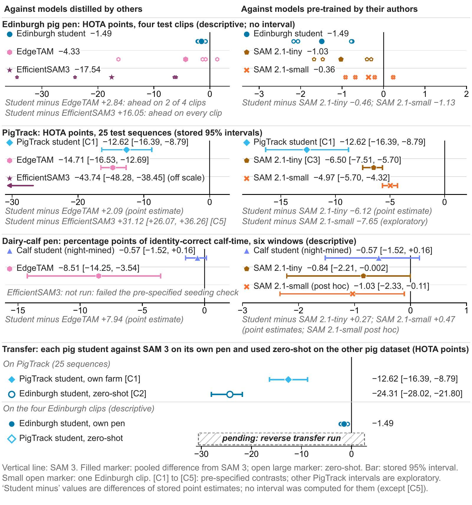
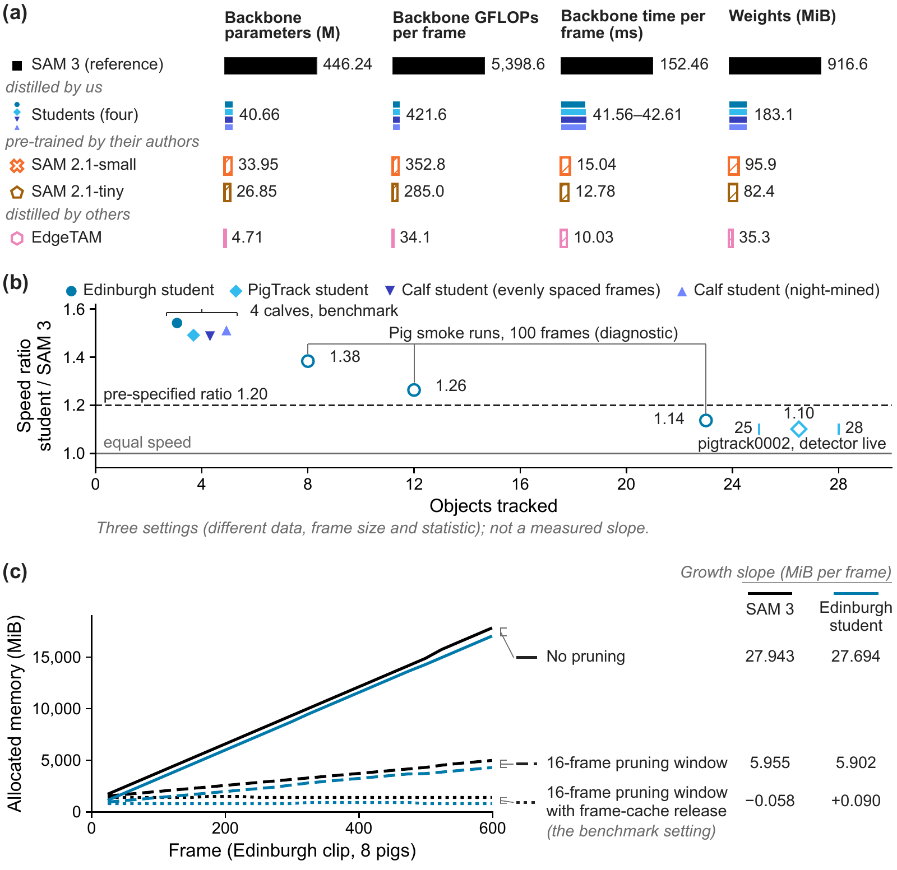
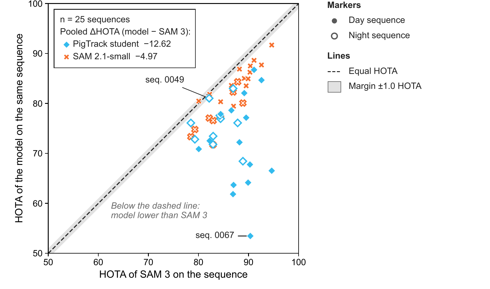
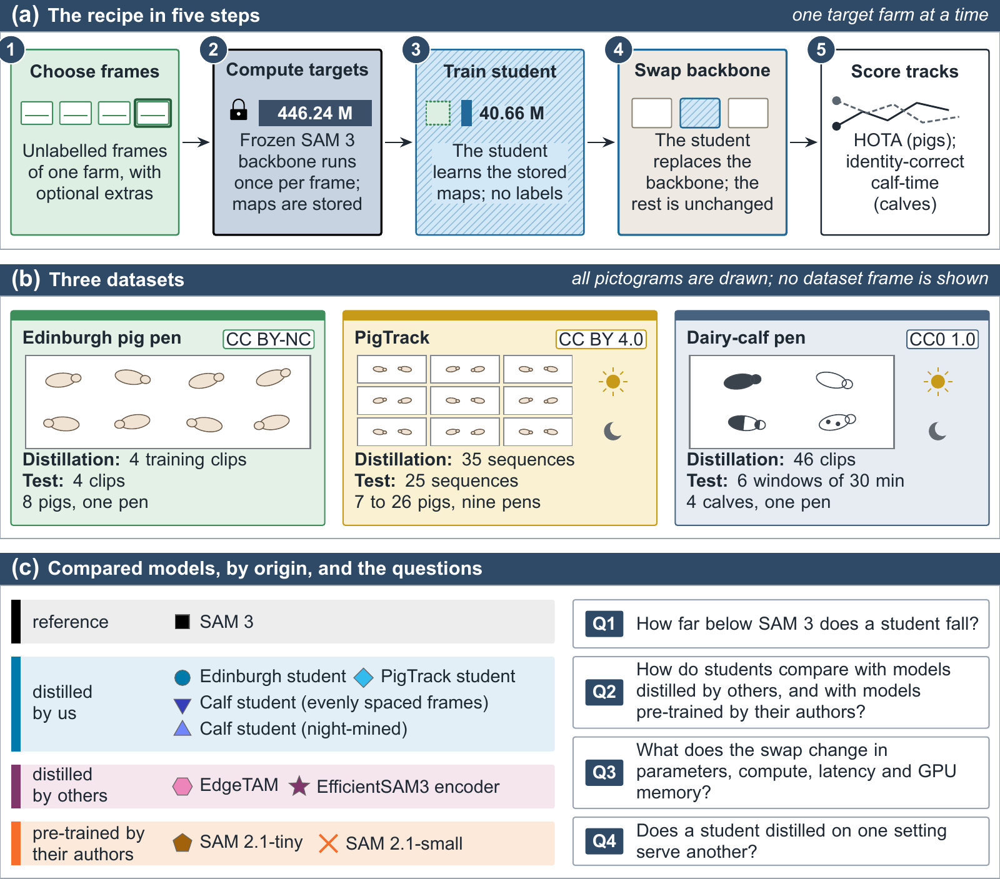

<p align="center">
  
</p>

<p align="center">
  <a href="https://arxiv.org/abs/2604.27128"></a>
  <a href="LICENSE"></a>
  <a href="docs/CHECKPOINTS.md"></a>
  <a href="docs/RESULTS.md"></a>
</p>

<p align="center">
  <a href="#headline-results">Results</a> ·
  <a href="#what-the-evidence-does-not-support">Limits</a> ·
  <a href="#quick-start">Quick start</a> ·
  <a href="#checkpoints">Checkpoints</a> ·
  <a href="#how-to-reproduce">Reproduce</a> ·
  <a href="#datasets-and-licences">Licences</a> ·
  <a href="#citation">Citation</a>
</p>

FarmSAM replaces the image backbone of SAM 3's video tracker with a TinyViT student. The student learns from unlabelled frames of one farm, and the rest of the tracker stays unchanged. We benchmarked it on pigs and dairy calves against SAM 3, SAM 2.1, EdgeTAM and the EfficientSAM3 encoder. The backbone drops from 446.24 M to 40.66 M parameters. The Edinburgh student and the night-mined calf student stay close to SAM 3 on their own pens (descriptive). The calf student on evenly spaced frames, on the same pen, does not. On PigTrack the student is materially worse, and it is not shown to be better than SAM 2.1.

## Headline results

**Size and speed.** One A10 vGPU, 4 objects, decode in the loop.

| Model | Backbone parameters | Total parameters | Backbone, ms per frame | End to end, fps |
|:---|---:|---:|---:|---:|
| SAM 3 | 446.24 M | 465.78 M | 152.46 | 3.2483 |
| Students (this work) | 40.66 M | 60.20 M | 41.56–42.61 | 4.8253–5.0087 |
| SAM 2.1-small | 33.95 M | 46.06 M | 15.04 | 7.8262 |
| SAM 2.1-tiny | 26.85 M | 38.96 M | 12.78 | 8.0014 |
| EdgeTAM | 4.71 M | 13.90 M | 10.03 | 13.0471 |

**Accuracy.** Each row uses its own student: distilled on that dataset.

| Dataset, metric | SAM 3 | Student (this work) | SAM 2.1-small | SAM 2.1-tiny | EdgeTAM | EfficientSAM3 encoder |
|:---|---:|---:|---:|---:|---:|---:|
| Edinburgh, pooled HOTA, 4 clips, reference boxes at first frame (Protocol A), descriptive | 75.5437 | 74.0540 | 75.1813 | 74.5168 | 71.2139 | 58.0042 |
| PigTrack, HOTA, 25 sequences, reference boxes at first frame (Protocol A) | 85.8720 | 73.2508 | 80.9033 | 79.3755 | 71.1625 | 42.1272 |
| Dairy calves, identity-correct %, descriptive | 99.80 | 99.23 night-mined<br>87.76 evenly spaced | 98.77 | 98.96 | 91.29 | no row |

- **PigTrack verdict.** ΔHOTA student − SAM 3 = −12.62 [95 % CI −16.39, −8.79], materially worse. With an RF-DETR detector in the loop: −10.51 [−14.00, −6.82], materially worse.
- **Edinburgh.** The tracks start from reference boxes. n = 4, so there is no interval and no verdict. Pooled ΔHOTA student − SAM 3 = −1.49.
- **Calves.** Six 30-minute windows, 4 calves. Night-mined student − SAM 3 = −0.57 pp [−1.52, +0.16], descriptive. This closeness does not hold for the calf student on evenly spaced frames: −12.04 pp [−15.62, −8.72].

<sub>**Calf reference.** Identity is scored against expert-verified identity chains on masks that the night-mined calf student produced in an earlier tracking run; mask agreement is measured against SAM 3. The masks are not manual segmentations. These numbers measure seeded-track continuity, not identity accuracy against independent ground truth. The SAM 2.1-small calf row was added post hoc. The EfficientSAM3 encoder failed the seeding gate on calves and has no row.</sub>

<sub>**EfficientSAM3 encoder.** EfficientSAM3 Stage-1 encoder inside SAM 3's unchanged tracker; Stage-2 memory weights unreleased as of 2026-10-08. Size 30.65 M [20.62 M TinyViT trunk]. Run on an A10 under our common bf16 protocol; agreement with the authors' code (mean mask IoU): 0.962 Edinburgh / 0.846 crowded PigTrack; we load the checkpoint before eval() so TinyViT attention biases are non-zero. With the authors' code as shipped (eval() before the checkpoint load, TinyViT attention biases left at zero) the agreement is 0.947 Edinburgh / 0.815 crowded PigTrack.</sub>

## What the evidence does not support

- **Accuracy retention on PigTrack.** The student is materially worse than SAM 3 under both protocols, even when distilled on the same farm's sequences.
- **The student as a better choice than SAM 2.1.** On PigTrack, SAM 2.1-small scores HOTA 80.90 against 73.25. It is also smaller (46.06 M against 60.20 M total) and faster (7.83 against 4.84 fps at 4 calves). No such contrast was pre-specified, so these have no interval. On Edinburgh the student is below both SAM 2.1 models (74.0540 against 75.1813 and 74.5168, descriptive). On calves the night-mined student's 99.23 is above 98.96 and 98.77 by point estimate, but no contrast was pre-specified, the intervals against SAM 3 overlap, and the student's own masks produced the reference.
- **Memory savings from distillation.** The memory bound comes from pruning plus frame-cache release. SAM 3's Edinburgh peak goes from 18,086.6 to 2,323.3 MiB with no student involved.
- **A constant speed-up.** The ratio is 1.49–1.54× at 4 objects and 1.10× end to end on one PigTrack sequence with 25 and 28 objects in the session.
- **Any edge-device claim.** Nothing was measured off the A10, and energy was not measurable on the vGPU.
- **Fidelity of 0.808 as held-out.** That preprint value came from training frames. Held-out Edinburgh is 0.7178 global, 0.757 per-patch.

Full tables, per-clip and per-window values, day and night, and every caveat: **[docs/RESULTS.md](docs/RESULTS.md)**. Required disclosures: [docs/DISCLOSURES.md](docs/DISCLOSURES.md).

<p align="center"></p>
<p align="center"><sub>Gaps to SAM 3. The "pending" row has no number: that run has not been made.</sub></p>

<p align="center"></p>
<p align="center"><sub>What the swap changes. The ratio falls with more objects; memory is bounded by pruning.</sub></p>

<p align="center"></p>
<p align="center"><sub>Per-sequence HOTA on PigTrack. Below the dashed line a model is lower than SAM 3.</sub></p>

## How it works

<p align="center"></p>

<p align="center"><sub>Targets are computed once from the frozen SAM 3 backbone. The student learns them without labels, then takes the backbone's place.</sub></p>

## Repository

```text
README.md
docs/          RESULTS  DISCLOSURES  REPRODUCE  CHECKPOINTS
figures/       every figure as PNG, one width, with SOURCES.csv
results/       one CSV per table, plus results/scores/ from the runs
distillation/  teacher targets, student training, mining (flat)
benchmark/     tracking, efficiency, gates, coverage audit, CODE_MANIFEST.csv
notebooks/     arxiv/: the three preprint notebooks, with corrections listed
tools/         script that builds results/*.csv
LICENSES/      SAM License, third-party notices
```

## Quick start

Using a student needs SAM 3's tracker weights from Meta. Accept the terms of the gated [`facebook/sam3`](https://huggingface.co/facebook/sam3) repository and log in to Hugging Face first. This repository holds no weights.

```bash
git clone https://github.com/Sonam525/FarmSAM && cd FarmSAM

# enough to load a student and compute features
pip install torch==2.7.0 torchvision transformers==5.2.0 timm==1.0.30 huggingface_hub Pillow "numpy<2.0"
hf auth login
```

The runs used Python 3.12.3. The tracker, detector and scoring packages are in [`requirements.txt`](requirements.txt), which has not been installed as a whole outside the run environment.

Load a student and compute one backbone feature map:

```python
import sys, torch
from huggingface_hub import hf_hub_download
from PIL import Image

sys.path.insert(0, "benchmark/core_bc46ecfb")
import tol_bench_core as core

path = hf_hub_download("Sonam5/FarmSAM", "pigtrack/pigtrack_student/best_backbone_student_pigtrack.pt")
student, meta = core.load_student(path, device="cuda")      # prefers the EMA weights, casts to bf16

x = core.make_student_transform()(Image.open("frame.jpg").convert("RGB"))
with torch.no_grad():
    features = student(x[None].to("cuda", torch.bfloat16))  # [1, 1024, 72, 72]
```

To run a full tracker, `core.load_arm` swaps the student into SAM 3's tracker; `benchmark/core_bc46ecfb/Tol_63_track_bench.py` shows the streaming loop.

> This snippet has not been run as written. The Hugging Face repository goes live after upload. See [docs/CHECKPOINTS.md](docs/CHECKPOINTS.md) before you load a `.pt` file.

## How to reproduce

The runs used Databricks: DBR 17.3 LTS ML GPU, one A10 for the benchmark and one A100 for training, transformers 5.2.0, torch 2.7.0. Paths come from a small registry, so you can point the code at your own storage. Accuracy scoring needs TrackEval at a pinned commit.

Step by step, with the script behind each number: **[docs/REPRODUCE.md](docs/REPRODUCE.md)**.

## Checkpoints

Nine student checkpoints, to be published at the planned repository [`Sonam5/FarmSAM`](https://huggingface.co/Sonam5/FarmSAM) (**links go live after upload**). Details, hashes and the loading notes are in [docs/CHECKPOINTS.md](docs/CHECKPOINTS.md).

| Student | Distilled on | Frames | Size | Terms |
|:---|:---|---:|---:|:---|
| [Edinburgh student](https://huggingface.co/Sonam5/FarmSAM/tree/main/edinburgh_noncommercial/edinburgh_student) | Edinburgh | 3,000 | 651 MB | non-commercial |
| [Edinburgh student (mined)](https://huggingface.co/Sonam5/FarmSAM/tree/main/edinburgh_noncommercial/edinburgh_student_mined) | Edinburgh | 3,627 | 651 MB | non-commercial |
| [PigTrack student](https://huggingface.co/Sonam5/FarmSAM/tree/main/pigtrack/pigtrack_student) | PigTrack | 3,000 | 651 MB | see below |
| [PigTrack student without drop-path](https://huggingface.co/Sonam5/FarmSAM/tree/main/pigtrack/pigtrack_student_no_droppath) | PigTrack | 3,000 | 651 MB | see below |
| [PigTrack student (mined)](https://huggingface.co/Sonam5/FarmSAM/tree/main/pigtrack/pigtrack_student_mined) | PigTrack | 5,125 | 651 MB | see below |
| [PigTrack student (random, draw 1)](https://huggingface.co/Sonam5/FarmSAM/tree/main/pigtrack/pigtrack_student_random1) | PigTrack | 5,125 | 651 MB | see below |
| [PigTrack student (random, draw 2)](https://huggingface.co/Sonam5/FarmSAM/tree/main/pigtrack/pigtrack_student_random2) | PigTrack | 5,125 | 651 MB | see below |
| [Calf student (evenly spaced)](https://huggingface.co/Sonam5/FarmSAM/tree/main/calf/calf_student_evenly_spaced) | Calf pen, 18–19 April | 3,846 | 325 MB | see below |
| [Calf student (night-mined)](https://huggingface.co/Sonam5/FarmSAM/tree/main/calf/calf_student_night_mined) | Calf pen, 18–19 April | 10,514 | 325 MB | see below |

<sub>Frames are training plus checkpoint-selection frames. Frame counts of rows with extra frames carry the disclosures in docs/DISCLOSURES.md.</sub>

## Datasets and licences

<p align="center">
  
</p>

<p align="center"><sub>All pictograms are drawn. No dataset frame is shown.</sub></p>

| Item | Terms | Use here |
|:---|:---|:---|
| [Edinburgh pig dataset](https://homepages.inf.ed.ac.uk/rbf/PIGDATA/) (Bergamini et al. 2021) | CC BY-NC | Unlabelled distillation frames and test clips. No Edinburgh frame is in this repository. |
| [PigTrack](https://doi.org/10.25625/P7VQTP) (Henrich et al.) | CC BY 4.0 | Distillation and test. Figures show PigTrack frames with overlays added. |
| [Dairy-calf dataset, FarmA_R1](https://huggingface.co/datasets/Sonam5/Calf-Play-Behavior-Dataset) | CC0 1.0 | Distillation and test. Access is on hold while people in the frames are masked. |
| [SAM 3](https://huggingface.co/facebook/sam3) | SAM License, gated | Teacher and tracker. Downloaded by you. Not redistributed. |
| SAM 2.1, EdgeTAM | Apache-2.0 tags upstream | Baselines. Downloaded by you. Not redistributed. |
| EfficientSAM3 | Apache-2.0 tag on the model card. The code sits in a fork of SAM 3 under the SAM License, and the checkpoint's other tensors are SAM 3 parameters | Baseline. Downloaded by you. Not redistributed. See [LICENSES/THIRD_PARTY.md](LICENSES/THIRD_PARTY.md). |
| [TinyViT](https://github.com/microsoft/Cream/tree/main/TinyViT) | MIT (code), Apache-2.0 tag on the `timm` weights | Student trunk, started from these weights. |

**Code** in this repository is MIT unless a file or the notice says otherwise. See [NOTICE.md](NOTICE.md) and [LICENSES/THIRD_PARTY.md](LICENSES/THIRD_PARTY.md).

**Weights** are not MIT. The students were trained to match SAM 3 backbone features and run inside SAM 3's tracker, so they ship with the [SAM License](LICENSES/SAM_LICENSE.txt). Clause 1.b.iv of the SAM License bars use that would "reverse engineer, decompile or discover the underlying components" of the SAM Materials. Whether that clause reaches a student trained on features is under review, and the weights wait for that answer. The two Edinburgh students were also distilled on CC BY-NC frames, so they are marked non-commercial, research only. Neither note is legal advice.

## Status

| Item | State |
|:---|:---|
| Preprint | [arXiv 2604.27128](https://arxiv.org/abs/2604.27128). Its notebooks are in [notebooks/arxiv/](notebooks/arxiv/README.md), with what later work corrected. |
| Revised manuscript | In preparation. |
| Reverse transfer: PigTrack student on Edinburgh test clips, zero-shot | **Pending.** The run has not been made, so no number exists. |
| Scorer and three helper files | Not in this draft. See `benchmark/CODE_MANIFEST.csv`. |
| Weights on Hugging Face | Pending upload. |

## Citation

```bibtex
@misc{yang2026distillation,
  title         = {Lightweight Distillation of {SAM}~3 and {DINOv3} for Edge-Deployable
                   Individual-Level Livestock Monitoring and Longitudinal Visual Analytics},
  author        = {Yang, Haiyu and Hostens, Miel},
  year          = {2026},
  eprint        = {2604.27128},
  archivePrefix = {arXiv},
  url           = {https://arxiv.org/abs/2604.27128}
}
```

The preprint's title and several of its claims predate this benchmark. Where they differ, this repository and [notebooks/arxiv/README.md](notebooks/arxiv/README.md) hold the current numbers.

If you use the students, please also acknowledge SAM 3, as the SAM License asks, and cite the dataset the student was distilled on.

## Authors

Haiyu Yang and Miel Hostens, College of Agriculture and Life Sciences, Cornell University. A veterinarian co-author joins them on the revised manuscript.

Questions and problems: [open an issue](https://github.com/Sonam525/FarmSAM/issues).
