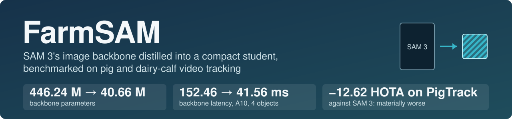
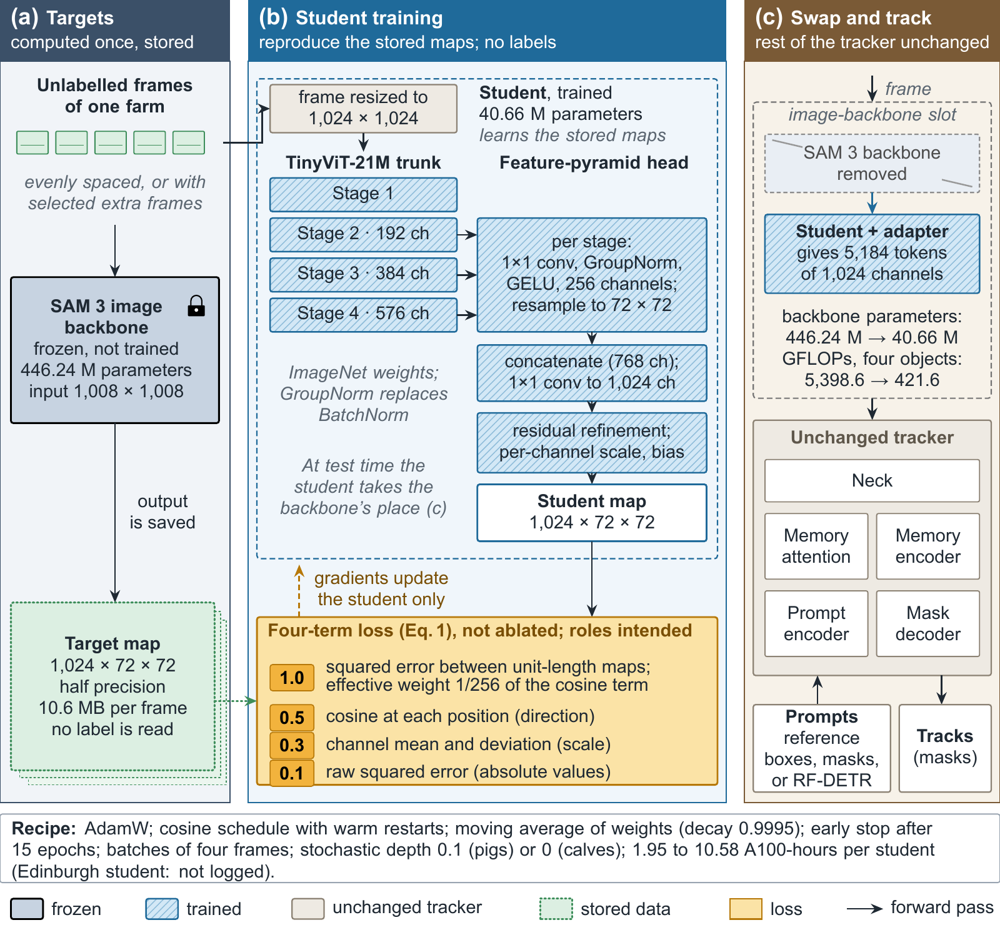
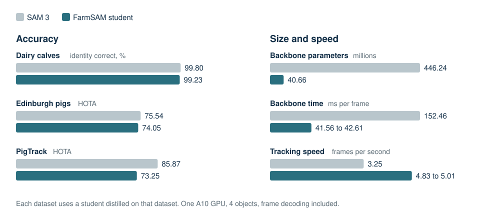

<p align="center">
  
</p>

<p align="center">
  <a href="https://arxiv.org/abs/2604.27128"></a>
  <a href="LICENSE"></a>
  <a href="LICENSES/SAM_LICENSE.txt"></a>
  <a href="https://huggingface.co/Sonam5/FarmSAM"></a>
  <a href="docs/RESULTS.md"></a>
</p>

<p align="center">
  <a href="#results">Results</a> ·
  <a href="#quick-start">Quick start</a> ·
  <a href="#checkpoints">Checkpoints</a> ·
  <a href="#train-your-own-student">Train your own</a> ·
  <a href="#datasets-and-licences">Licences</a> ·
  <a href="#citation">Citation</a>
</p>

FarmSAM makes SAM 3's video tracker lighter for farm cameras. It replaces the 446 M image backbone with a 41 M TinyViT student that learns from unlabelled frames of the farm where it will run. The memory, mask decoder and everything else in the tracker stay as they are.

- **No labels needed.** The student learns SAM 3's own backbone features, so a new farm only needs video.
- **Close to SAM 3 on calves.** Over six 30-minute windows, day and night, the calf student keeps identity correct 99.23 % of the time. SAM 3 scores 99.80 %.
- **Lighter and faster.** The backbone is 91 % smaller and 3.6× faster, and full tracking runs about 1.5× faster with 4 animals.
- **Ready to try.** Students for pigs and dairy calves are on [Hugging Face](https://huggingface.co/Sonam5/FarmSAM).

## How it works

<p align="center"></p>

SAM 3's frozen backbone runs once over a set of frames and its feature maps are stored. The student learns to reproduce those maps, then takes the backbone's place in the tracker.

## Results

<p align="center"></p>

**Accuracy.** Each row uses a student distilled on that dataset. Tracks start from reference boxes or masks at the first frame.

| Dataset, metric | Student (this work) | SAM 3 | SAM 2.1-small | SAM 2.1-tiny | EdgeTAM | EfficientSAM3 encoder |
|:---|---:|---:|---:|---:|---:|---:|
| Dairy calves, identity-correct %, 6 windows | **99.23** | 99.80 | 98.77 | 98.96 | 91.29 | – |
| Edinburgh pigs, HOTA, 4 clips | **74.05** | 75.54 | 75.18 | 74.52 | 71.21 | 58.00 |
| PigTrack, HOTA, 25 sequences | **73.25** | 85.87 | 80.90 | 79.38 | 71.16 | 42.13 |

**Size and speed.** One A10 GPU, 4 objects, frame decoding included.

| Model | Backbone parameters | Total parameters | Backbone, ms per frame | End to end, fps |
|:---|---:|---:|---:|---:|
| Student (this work) | 40.66 M | 60.20 M | 41.56–42.61 | 4.83–5.01 |
| SAM 3 | 446.24 M | 465.78 M | 152.46 | 3.25 |
| SAM 2.1-small | 33.95 M | 46.06 M | 15.04 | 7.83 |
| SAM 2.1-tiny | 26.85 M | 38.96 M | 12.78 | 8.00 |
| EdgeTAM | 4.71 M | 13.90 M | 10.03 | 13.05 |

Calf identity is scored against identity chains that experts verified, on masks from an earlier run of the calf student, so it measures how well a track stays on its animal rather than mask quality. The speed gain is largest with few animals and shrinks as the number of tracked objects grows. Memory stays bounded through pruning and frame-cache release. All timings are from one A10, so please measure on your own hardware, and test a student on your own pen before you rely on it.

Full tables, per-clip values, day and night, and notes on the compared models: **[docs/RESULTS.md](docs/RESULTS.md)**.

## Quick start

Using a student needs SAM 3's tracker weights from Meta. Accept the terms of the gated [`facebook/sam3`](https://huggingface.co/facebook/sam3) repository and log in to Hugging Face first. Student weights download from Hugging Face.

```bash
git clone https://github.com/Sonam525/FarmSAM && cd FarmSAM

# enough to load a student and compute features
pip install torch==2.7.0 torchvision transformers==5.2.0 timm==1.0.30 huggingface_hub Pillow "numpy<2.0"
hf auth login
```

The runs used Python 3.12.3. The full package list, with the tracker, detector and scoring tools, is in [`requirements.txt`](requirements.txt).

Load a student and compute one backbone feature map:

```python
import sys, torch
from huggingface_hub import hf_hub_download
from PIL import Image

sys.path.insert(0, "benchmark/core")
import bench_core as core

path = hf_hub_download("Sonam5/FarmSAM", "calf/calf_student_night_mined/best_backbone_student_v2.pt")
student, meta = core.load_student(path, device="cuda")      # prefers the EMA weights, casts to bf16

x = core.make_student_transform()(Image.open("frame.jpg").convert("RGB"))
with torch.no_grad():
    features = student(x[None].to("cuda", torch.bfloat16))  # [1, 1024, 72, 72]
```

To run a full tracker, `core.load_arm` swaps the student into SAM 3's tracker; `benchmark/core/track_bench.py` shows the streaming loop.

> Our benchmark ran on Databricks, so this snippet may need small changes on your machine. If it does, please [open an issue](https://github.com/Sonam525/FarmSAM/issues). Check the hashes in [docs/CHECKPOINTS.md](docs/CHECKPOINTS.md) before you load a `.pt` file.

## Train your own student

You need SAM 3 access, unlabelled frames from your farm and a GPU. About 3,000 frames trained in a few hours on one A100. Step-by-step notes are in **[docs/REPRODUCE.md](docs/REPRODUCE.md)**.

## Checkpoints

Students and detectors are on Hugging Face at [`Sonam5/FarmSAM`](https://huggingface.co/Sonam5/FarmSAM). Hashes and loading notes are in [docs/CHECKPOINTS.md](docs/CHECKPOINTS.md).

| Student | Distilled on | Frames | Size | Terms |
|:---|:---|---:|---:|:---|
| [Calf student (night-mined)](https://huggingface.co/Sonam5/FarmSAM/tree/main/calf/calf_student_night_mined) | Dairy calves, day and night | 10,514 | 325 MB | SAM License |
| [PigTrack student](https://huggingface.co/Sonam5/FarmSAM/tree/main/pigtrack/pigtrack_student) | PigTrack | 3,000 | 651 MB | SAM License |
| [Edinburgh student](https://huggingface.co/Sonam5/FarmSAM/tree/main/edinburgh_noncommercial/edinburgh_student) | Edinburgh | 3,000 | 651 MB | SAM License, non-commercial |

| RF-DETR detector | Trained on | Size | Terms |
|:---|:---|---:|:---|
| [Calf detector](https://huggingface.co/Sonam5/FarmSAM/tree/main/detectors/calf_rfdetr_seg), Seg Small, 624 px | Dairy calves, 18 and 19 April | 136 MB | SAM License |
| [PigTrack detector](https://huggingface.co/Sonam5/FarmSAM/tree/main/detectors/pigtrack_rfdetr), Small, 512 px | PigTrack | 127 MB | Apache-2.0 |
| [Edinburgh detector](https://huggingface.co/Sonam5/FarmSAM/tree/main/edinburgh_noncommercial/edinburgh_rfdetr), Small, 512 px | Edinburgh, from the PigTrack detector | 127 MB | Apache-2.0, non-commercial |

## Datasets and licences

| Item | Terms | Use here |
|:---|:---|:---|
| [Edinburgh pig dataset](https://homepages.inf.ed.ac.uk/rbf/PIGDATA/) (Bergamini et al. 2021) | CC BY-NC | Unlabelled distillation frames and test clips. No Edinburgh frame is in this repository. |
| [PigTrack](https://doi.org/10.25625/P7VQTP) (Henrich et al.) | CC BY 4.0 | Distillation and test. Figures show PigTrack frames with overlays added. |
| [Dairy-calf dataset, FarmA_R1](https://huggingface.co/datasets/Sonam5/Calf-Play-Behavior-Dataset) | CC0 1.0 | Distillation and test. Access is on hold while people in the frames are masked. |
| [SAM 3](https://huggingface.co/facebook/sam3) | SAM License, gated | Teacher and tracker. Downloaded by you. Not redistributed. |
| SAM 2.1, EdgeTAM | Apache-2.0 tags upstream | Baselines. Downloaded by you. Not redistributed. |
| EfficientSAM3 | Apache-2.0 tag on the model card. The code sits in a fork of SAM 3 under the SAM License, and the checkpoint's other tensors are SAM 3 parameters | Baseline. Downloaded by you. Not redistributed. See [LICENSES/THIRD_PARTY.md](LICENSES/THIRD_PARTY.md). |
| [TinyViT](https://github.com/microsoft/Cream/tree/main/TinyViT) | MIT (code), Apache-2.0 tag on the `timm` weights | Student trunk, started from these weights. |

**Code** in this repository is MIT, except parts under other terms. See [NOTICE.md](NOTICE.md) and [LICENSES/THIRD_PARTY.md](LICENSES/THIRD_PARTY.md).

**Weights** are not MIT. All students and the calf detector are released under the [SAM License](LICENSES/SAM_LICENSE.txt); the two pig detectors are fine-tuned RF-DETR models under Apache-2.0. The students were trained to match SAM 3 backbone features and run inside SAM 3's tracker, so we apply its terms to be safe. If you pass a student on, you must do so under those terms and include a copy of the licence. Its trade control limits apply.

**Non-commercial limit.** The Edinburgh student and detector, in `edinburgh_noncommercial/`, may be used for non-commercial purposes only. Both were trained on frames of the Edinburgh pig dataset, which is CC BY-NC. This limit comes from the data licence and applies on top of the other terms.

These notes are not legal advice.

## Citation

```bibtex
@misc{yang2026distillation,
  title         = {Lightweight Distillation of {SAM}~3 and {DINOv3} for Edge-Deployable
                   Individual-Level Livestock Monitoring and Longitudinal Visual Analytics},
  author        = {Yang, Haiyu and Hostens, Miel},
  year          = {2026},
  eprint        = {2604.27128},
  archivePrefix = {arXiv},
  url           = {https://arxiv.org/abs/2604.27128}
}
```

This repository holds the latest numbers, from a benchmark newer than the preprint. The preprint's notebooks are in [notebooks/arxiv/](notebooks/arxiv/README.md).

If you publish results from a student, you must acknowledge SAM 3: clause 1.b.ii of the SAM License requires it. Please also cite the dataset the student was distilled on.

## Authors

Haiyu Yang and Miel Hostens, College of Agriculture and Life Sciences, Cornell University. A veterinarian co-author joins them on the revised manuscript.

Questions and problems: [open an issue](https://github.com/Sonam525/FarmSAM/issues).
