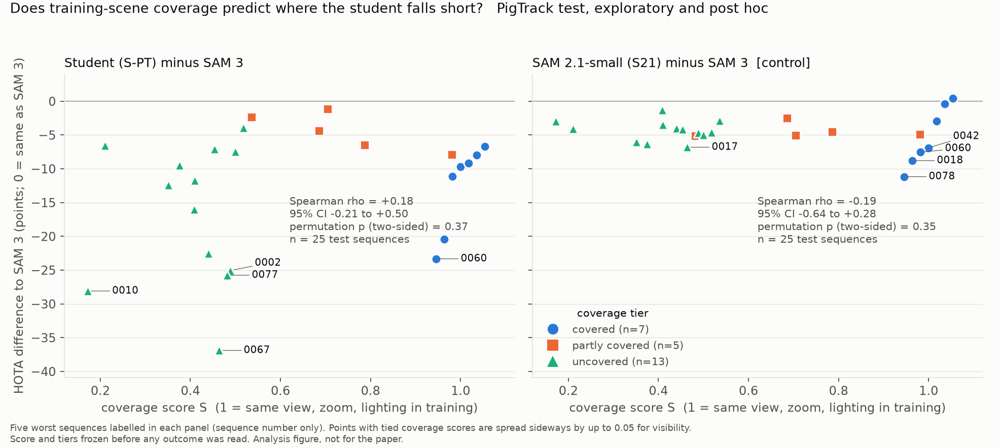
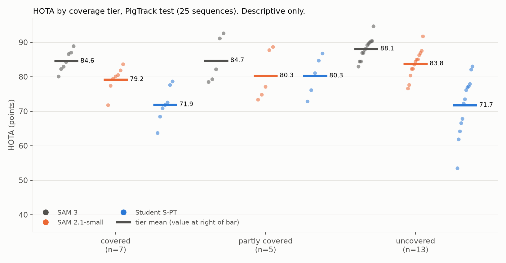
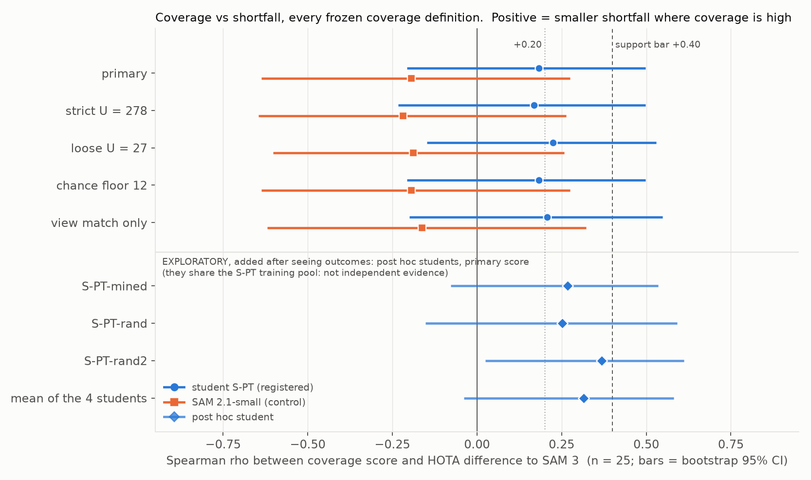

# PigTrack scene-coverage audit: results

**EXPLORATORY and POST HOC. Not a registered result and not a claim of the paper.** It asks whether the PigTrack student's shortfall follows how well the training set covers each test scene. Figures here are for analysis only.

Plan applied: `AUDIT_PLAN.md` (sha256 `801794b5883be609...`), frozen 2026-10-27T18:24:47Z, verified unchanged at 2026-10-27T18:36:36Z (all seven frozen files match). Seed 20261027, B = 10,000 bootstrap resamples, percentile 95% CI, mid-ranks for ties, n = 25 test sequences, **no multiplicity correction anywhere**. Every item not in the frozen plan is marked **"EXPLORATORY, added after seeing outcomes"**.

## 1. Plain-language summary

**Decision under the frozen rule (plan section 7, applied literally): NOT SUPPORTED.** The student's HOTA shortfall to SAM 3 is only weakly, and not detectably, related to how well the training set covers the scene (Spearman rho = +0.18, 95% CI [-0.21, +0.50], permutation p = 0.37 two-sided; the support bar was rho >= +0.40 with the CI above 0). The NOT SUPPORTED label fired because rho is below +0.20 (it is 0.017 below the line); the second trigger, a CI upper bound under +0.40, did not fire (upper bound +0.50). With n = 25 this is **weak evidence against an effect, not evidence of none**: the plan's own simulation says a true rho of 0.2 to 0.3 is labelled "not supported" 52% to 34% of the time.

**Does coverage, as measured, predict where the student fails?** Not in this data.
- *How many test sequences are covered?* **7 covered, 5 partly covered, 13 uncovered** (of 25). "Covered" is a high bar: it means the camera view, zoom and lighting of some training sequence match. Even among the 31 training sequences only 7 have such a twin in the rest of the training set.
- *Shortfall to SAM 3 by tier* (mean HOTA points, student minus SAM 3): covered **-12.6** (SD 6.5), partly covered **-4.4** (SD 2.8), uncovered **-16.4** (SD 10.3). The ordering is not monotone: the five partly covered sequences are the student's best, and covered minus uncovered is only +3.7 points (95% CI [-3.4, +10.6], interval includes 0). Even on covered scenes the student is 12.6 points below SAM 3.
- *Where the difference comes from.* The student's own HOTA is the same on covered and uncovered scenes (71.9 vs 71.7). What differs is the yardstick: SAM 3 is lower on covered scenes (84.6 vs 88.1) and so is SAM 2.1-small (79.2 vs 83.8). So the small positive covered-versus-uncovered difference is a lower reference, not a better student (EXPLORATORY, added after seeing outcomes; section 5.3).
- *Adjustments and definitions.* Adjusting for night and objects per sequence gives a partial rho of +0.17 (bar +0.30; CI [-0.27, +0.54]); with the 1080p camera added +0.25. Under the strict / loose coverage thresholds rho is +0.17 / +0.22 (bar +0.30 in both: not met). Dropping any one pen leaves rho between +0.08 and +0.26; dropping pen 7 leaves +0.08, so even the small positive value rests on a few pens.

**What does the control show?** SAM 2.1-small is a generalist that we did not distil or fine-tune on PigTrack, so any coverage effect on its gap to SAM 3 would reflect scene difficulty, not familiarity. Its gap is *not* related to coverage (rho = -0.19, CI [-0.64, +0.28]). The difference between the two correlations is +0.38 (CI [-0.20, +0.92]); the plan's point-estimate rule for "control clearly weaker" is met, but the interval includes 0, so by the plan's own wording the contrast is **suggestive only**, and it carries little weight because the main correlation is itself small. Across sequences the student's shortfall and SAM 2.1-small's shortfall are unrelated (rho = -0.07, EXPLORATORY, added after seeing outcomes), so the student's failures are not generic scene difficulty.

**Where the student does fail.** 7 sequences are more than 20 points below SAM 3: 5 uncovered, 2 covered, 0 partly covered. The five worst are 0067 (uncovered, -36.9), 0010 (uncovered, -28.1), 0077 (uncovered, -25.7), 0002 (uncovered, -25.0), 0060 (covered, -23.3). One of them (0060) has a same-view training twin (499 homography inliers) and is still 23 points down. Camera view, zoom and lighting, as measured here, do not cleanly separate the failures from the successes.

**Exploratory checks that add something (EXPLORATORY, added after seeing outcomes).**
- *The post hoc students* (S-PT-mined, -rand, -rand2) lean more positive (rho +0.25 to +0.37; mean of the four students +0.32, CI [-0.04, +0.58]). They share S-PT's training pool and their D vectors correlate 0.78 to 0.89 with each other, so this is one result seen four times, not four results. It is consistent with a true effect of about +0.2 to +0.4 that n = 25 cannot resolve.
- *Gain over a student that never saw PigTrack.* Where coverage does show a clear signal is the benefit of PigTrack distillation relative to S-Edi (the Edinburgh-pig student): on the 20 official-val sequences the gain is +13.8 (covered, n = 4), +11.5 (partly, n = 5) and **-0.5** (uncovered, n = 11) HOTA points; rho(coverage, gain) = +0.70, CI [+0.36, +0.88]. On the 25 test sequences the sign agrees but is weaker (gain +17.4 / +21.2 / +8.0; rho +0.22, CI [-0.15, +0.53]). Read literally: PigTrack distillation helped on views present in training and, on val, by about zero points on views absent from it. That is a statement about the *gain from distillation*, not about the *gap to SAM 3*, and both can be true at once: the student gets better on seen views and is still 12.6 points under SAM 3 there. Section 5.4 shows how far this survives pen clustering, leave-one-pen-out and the A4 covariates.

**What this means for the choice (information, not a verdict).** The plan's own reading guide applies: when the main test is not supported, this definition of "unseen scene" does not explain the shortfall, which neither licenses nor refutes the fairness concern. Concretely, with these data: (i) a camera-view match to the training set does not by itself predict a smaller gap to SAM 3, so a seen-versus-unfamiliar split on *the gap to SAM 3* would not show a clean contrast; (ii) a seen-versus-unfamiliar split on *the gain over a non-PigTrack student* does show one on val, which is the form of option (b) that these data can support, still post hoc and on 20 to 25 sequences; (iii) none of this changes the registered PigTrack result or the fact that the student is well below SAM 3 on this set.

**Caveats that bound everything above.**
- **n = 25** test sequences from 9 pens (sizes 1, 4, 4, 3, 1, 4, 4, 2, 2); sequences within a pen are not independent. Nothing here is confirmatory; no multiplicity correction.
- **Blinding was incomplete and the controller had already seen the per-sequence numbers**: the task text stated the shortfall distribution (mean -12.9, SD 9.3, range -36.9 for 0067 to -1.1 for 0049), the earlier pen-label-only correlations (+0.22, p 0.29; night +0.45) and the pen-7 montage before the Define step began. Thresholds came from the validation controls and conventions fixed before the first tier was computed, and the plan was hashed before any outcome file was opened (section 8), but the analysts knew the two extreme sequences.
- **The measure is a proxy for "seen".** It tests whether a training sequence shares the camera view (SIFT homography on background medians), zoom and lighting. It says nothing about animal appearance, posture or crowding, and the student saw about 85 frames per training sequence. "Uncovered" means no matching camera view in the 31 training sequences, not "never saw anything similar". SIFT is blind across IR versus colour, so four night sequences are uncovered partly through that blind spot (variant `penaware`, section 4).
- **Low power.** A true rho of 0.3 meets the support rule 25% of the time; only rho of about 0.6 or more would be detected reliably. The plan's reading of a failure is therefore "weak evidence of absence".
- **Coverage is confounded with the 1080p camera** (all four pen-3 test sequences are covered; Spearman(score, is1080) = +0.55) and with the yardstick: coverage correlates -0.36 with SAM 3's own HOTA.

## 2. Decision rule applied literally (plan section 7)

| condition (frozen) | observed | held? |
|---|---|---|
| A1: rho >= +0.40 and CI lower bound > 0 | rho +0.18, CI [-0.21, +0.50] | **no** |
| A2: covered minus uncovered > 0 with CI lower bound > 0 | +3.75, CI [-3.38, +10.58] | **no** |
| A3: control clearly weaker (rho_ctrl <= 0.5 x rho_A1 and delta rho >= +0.25, point estimates) | rho_ctrl -0.19, 0.5 x rho_A1 = +0.09; delta rho +0.38 | **yes** |
| A3 qualifier: delta rho CI lower bound > 0, else suggestive only | CI [-0.20, +0.92] | no (suggestive only) |
| A4: partial rho >= +0.30 (night, objects) | +0.17, CI [-0.27, +0.54] | **no** |
| A5: rho >= +0.30 under strict U = 278 | +0.17 | **no** |
| A5: rho >= +0.30 under loose U = 27 | +0.22 | **no** |
| NOT SUPPORTED trigger: A1 rho < +0.20 | +0.18 | **yes** |
| NOT SUPPORTED trigger: A1 CI upper bound < +0.40 | +0.50 | no |

Result: SUPPORTED needs all of A1, A2, A3, A4, A5; only the A3 point-estimate rule held (and its CI is not above 0). A1 rho is below +0.20, so the label is **NOT SUPPORTED**. Honest margin: rho is 0.017 under the line, and two sensitivity variants sit above +0.20 (loose U +0.22, view-match-only +0.21); under either of those the same rule would read INCONCLUSIVE. The plan names the primary definition as the one that governs, so the label stands; none of the three labels is a verdict on whether PigTrack is a fair benchmark.

## 3. Frozen-plan results (A1 to A6, D1)

Outcome files: primary `_results/j7v/score_main/per_sequence.csv` (T, S21, S-PT, S-Edi, 25 test sequences, HOTA). Cross-check against the `pt_mining/scores/` `ref_arm = T` file: largest per-sequence difference **0.0** HOTA points for each of T, S21, S-PT, S-Edi (none above the 0.05 reporting threshold); all five `pt_mining` score directories agree on every shared arm (max difference 0.0). The 25 sequences equal the test rows of `coverage_table.csv` (asserted); nothing imputed. D_PT = HOTA(S-PT) - HOTA(SAM 3) has mean -12.93, SD 9.27, range -36.88 (0067) to -1.10 (0049); D_21 = HOTA(S21) - HOTA(SAM 3) has mean -4.62, SD 2.53. Both match the figures quoted in the task. Invalid bootstrap draws: 0 in every analysis below.

**ESTIMATES, n = 25, percentile bootstrap 95% CI over sequences (B = 10,000, seed 20261027).**

| id | analysis | estimate | 95% CI | note |
|---|---|---|---|---|
| A1 | Spearman rho(coverage score, D_PT) | **+0.18** | [-0.21, +0.50] | permutation p: 0.18 one-sided (positive), 0.37 two-sided [added, section 5.1] |
| A2 | mean D_PT covered (7) minus uncovered (13) | **+3.75** | [-3.38, +10.58] | means -12.62 vs -16.37; stratified bootstrap |
| A3 | control: rho(coverage, D_21) | **-0.19** | [-0.64, +0.28] | permutation p two-sided 0.35 [added] |
| A3 | control: covered minus uncovered, D_21 | **-1.01** | [-4.08, +2.12] | means -5.33 vs -4.32 |
| A3 | delta rho = rho(S, D_PT) - rho(S, D_21), paired | **+0.38** | [-0.20, +0.92] | CI includes 0: suggestive only |
| A4 | partial Spearman, adjusted for night + objects | **+0.17** | [-0.27, +0.54] | rank-OLS standardised beta +0.15; 21 residual df |
| A4b | + is1080 | **+0.25** | [-0.24, +0.63] | beta +0.28; robustness read only |
| A4 control | partial rho for D_21 (night + objects / + is1080) | -0.10 / -0.08 | [-0.55, +0.41] (first) | EXPLORATORY, added after seeing outcomes (control partial) |
| D1 | pen-cluster bootstrap of rho (9 pens) | **+0.18** | [-0.21, +0.49] | |
| D1 | leave-one-pen-out rho, range | +0.08 to +0.26 | n/a | min when pen 7 dropped, max when pen 8 dropped |

Leave-one-pen-out rho (pen dropped: rho): 1: +0.187, 2: +0.175, 3: +0.203, 4: +0.166, 5: +0.085, 6: +0.234, 7: +0.079, 8: +0.263, 9: +0.228. Pen 3 (the 1080p camera) dropped: +0.203; the plan's trigger (sign change or below +0.20) is **not met**, by a margin of 0.003. Dropping pen 5 or pen 7 takes rho to +0.085 / +0.079.

### A2 descriptive table (no test): per tier, mean (SD) in HOTA points

| tier | n | D_PT = S-PT - SAM 3 | D_21 = S21 - SAM 3 | HOTA SAM 3 | HOTA S21 | HOTA S-PT | HOTA S-Edi |
|---|---|---|---|---|---|---|---|
| covered | 7 | -12.6 (6.5) | -5.3 (4.4) | 84.6 (3.1) | 79.2 (3.8) | 71.9 (5.1) | 54.6 |
| partly covered | 5 | -4.4 (2.8) | -4.4 (1.1) | 84.7 (6.7) | 80.3 (7.3) | 80.3 (5.8) | 59.1 |
| uncovered | 13 | -16.4 (10.3) | -4.3 (1.5) | 88.1 (3.1) | 83.8 (4.1) | 71.7 (8.6) | 63.8 |
| all 25 | 25 | -12.9 (9.3) | -4.6 (2.5) | 86.4 (4.2) | 81.8 (5.0) | 73.5 (7.8) | 60.3 |

### A6 (post hoc, DESCRIPTIVE only): mean of S-PT minus S21

*Restricting a registered contrast to a subset afterwards is not a registered contrast.* No inference, no claim; it only shows whether the student-versus-generalist gap looks different where coverage is high.

| subset | n | mean (HOTA points) | SD | bootstrap 95% CI of the mean |
|---|---|---|---|---|
| covered | 7 | -7.29 | 6.00 | [-11.41, -3.29] |
| all 25 | 25 | -8.31 | 9.64 | [-12.23, -4.79] |
| partly covered | 5 | -0.04 | 3.16 | [-2.38, +2.53] |
| uncovered | 13 | -12.05 | 10.97 | [-18.01, -6.38] |

Student minus SAM 2.1-small is negative on covered scenes (-7.3) and about as large as on all 25 (-8.3); the partly covered tier is the only place the two are level. Nothing here is a coverage effect on the registered contrast.

## 4. A5 sensitivity: every definition of coverage

All variants come from the frozen `coverage_table_variants.csv`; none replaces the primary. Tier counts are for the 25 test sequences.

| definition | covered / partly / uncovered | rho S-PT (95% CI) | rho S21 control (95% CI) | delta rho (95% CI) | A2 covered - uncovered (95% CI) | A2 control | A4 partial rho (95% CI) | A4b |
|---|---|---|---|---|---|---|---|---|
| **primary** | 7 / 5 / 13 | +0.18 [-0.21, +0.50] | -0.19 [-0.64, +0.28] | +0.38 [-0.20, +0.92] | +3.7 [-3.4, +10.6] (n 7 vs 13) | -1.0 | +0.17 [-0.27, +0.54] | +0.25 |
| strict U = 278 | 4 / 8 / 13 | +0.17 [-0.23, +0.50] | -0.22 [-0.65, +0.26] | +0.39 [-0.20, +0.92] | +1.3 [-7.3, +10.0] (n 4 vs 13) | -1.6 | +0.15 [-0.28, +0.52] | +0.23 |
| loose U = 27 | 9 / 3 / 13 | +0.22 [-0.15, +0.53] | -0.19 [-0.60, +0.26] | +0.41 [-0.14, +0.92] | +5.0 [-1.6, +11.6] (n 9 vs 13) | -0.9 | +0.22 [-0.23, +0.58] | +0.30 |
| chance floor 12 (`floorL12`) | 7 / 4 / 14 | +0.18 [-0.21, +0.50] | -0.19 [-0.64, +0.28] | +0.38 [-0.20, +0.92] | +2.7 [-4.4, +9.6] (n 7 vs 14) | -0.9 | +0.17 [-0.27, +0.54] | +0.25 |
| view match only (`viewonly`) | 7 / 5 / 13 | +0.21 [-0.20, +0.55] | -0.16 [-0.62, +0.32] | +0.37 [-0.24, +0.93] | +3.7 [-3.4, +10.6] (n 7 vs 13) | -1.0 | +0.21 [-0.20, +0.59] | +0.32 |
| `penaware` (four IR-vs-colour sequences recoded partly covered; A2 only) | 7 / 9 / 9 | n/a | n/a | n/a | +7.4 [-0.5, +15.0] (n 7 vs 9) | -1.4 | n/a | n/a |

Across the five definitions the student's rho ranges +0.17 to +0.22 and the control rho -0.22 to -0.16; every one of the ten CIs includes 0. The `penaware` variant has the largest A2 difference (+7.4, CI [-0.5, +15.0]) because it moves the four night sequences from uncovered to partly covered, which also changes the tier sizes to 7 / 9 / 9; its CI still includes 0 (lower bound -0.5).

## 5. EXPLORATORY, added after seeing outcomes

Everything in this section is outside the frozen plan. Nothing is a test of H; no multiplicity correction; nothing is a claim.

### 5.1 Permutation test (named in the task, not in the plan)

10,000 random permutations of D, seed 20261027. A1: p = 0.184 one-sided (positive), 0.371 two-sided. Control A3: p = 0.827 one-sided (positive), 0.353 two-sided. Permutation p values for all variants are in the results JSON. Leave-one-sequence-out rho(S, D_PT) ranges +0.085 (without 0010) to +0.265 (without 0054); without 0067 +0.174, without 0049 +0.168. The two extreme sequences the controller already knew do not drive the estimate.

### 5.2 The three post hoc students and the base student

They share the base pool of 2,626 distillation targets (31 whitelisted training sequences); S-PT-mined, S-PT-rand, S-PT-rand2 are post hoc variants of S-PT. **They are not independent evidence** (pairwise Spearman between their D vectors: PT vs PT-mined 0.86, PT vs PT-rand 0.78, PT vs PT-rand2 0.89, PT-mined vs PT-rand 0.80, PT-mined vs PT-rand2 0.83, PT-rand vs PT-rand2 0.79). "Mean of 4" averages their per-sequence D, which reduces seed noise but not the n = 25 limit. D = HOTA(arm) - HOTA(SAM 3); primary coverage score and tiers; control column is S21 as in A3.

| student | mean D | rho (95% CI) | perm p one-sided | covered - uncovered (95% CI) | partial rho night+objects (95% CI) | delta rho vs S21 (95% CI) | plan label if the S-PT rule were applied (see note) |
|---|---|---|---|---|---|---|---|
| S-PT (registered) | -12.93 | +0.18 [-0.21, +0.50] | 0.184 | +3.7 [-3.4, +10.6] | +0.17 [-0.27, +0.54] | +0.38 [-0.20, +0.92] | NOT SUPPORTED (rho < 0.20) |
| S-PT-mined | -13.32 | +0.27 [-0.08, +0.53] | 0.096 | +7.7 [+1.2, +14.3] | +0.27 [-0.17, +0.57] | +0.46 [-0.05, +0.93] | INCONCLUSIVE (0.20 <= rho) |
| S-PT-rand | -13.25 | +0.25 [-0.15, +0.59] | 0.111 | +6.3 [-2.5, +14.9] | +0.28 [-0.17, +0.62] | +0.45 [-0.03, +0.91] | INCONCLUSIVE (0.20 <= rho) |
| S-PT-rand2 | -14.11 | +0.37 [+0.02, +0.61] | 0.034 | +9.9 [+2.8, +17.5] | +0.40 [-0.02, +0.69] | +0.56 [+0.08, +1.02] | INCONCLUSIVE (0.20 <= rho) |
| mean of the 4 | -13.40 | +0.32 [-0.04, +0.58] | 0.058 | +6.9 [+0.0, +13.9] | +0.33 [-0.09, +0.65] | +0.51 [+0.07, +0.94] | INCONCLUSIVE (0.20 <= rho) |

Note: the plan's labels were pre-specified for S-PT only; applying them to the other rows is a convenience for reading, not a rule. Of the five rows, one rho CI excludes 0 (S-PT-rand2) and three covered-minus-uncovered CIs exclude 0 (S-PT-mined, S-PT-rand2, and the mean of the four, whose lower bound is just above 0). With five strongly correlated looks and no correction, that is about the excess one would expect from one result viewed several ways.

### 5.3 Why covered-versus-uncovered is partly a yardstick effect

| quantity (n = 25) | Spearman rho | 95% CI |
|---|---|---|
| coverage vs SAM 3 HOTA | -0.36 | [-0.65, +0.02] |
| coverage vs S21 HOTA | -0.36 | [-0.67, +0.03] |
| coverage vs S-PT HOTA | +0.01 | [-0.37, +0.37] |
| D_PT vs SAM 3 HOTA (shortfall vs teacher level) | -0.52 | [-0.82, -0.11] |
| D_PT vs D_21 (two shortfalls) | -0.07 | [-0.43, +0.30] |

SAM 3 and SAM 2.1-small score lower on covered scenes (coverage-vs-HOTA rho about -0.36), the student's HOTA is flat across coverage (rho +0.01), and the shortfall is larger where SAM 3 is strongest (rho -0.52, CI excludes 0). A shortfall that subtracts SAM 3 therefore moves against a coverage benefit on this set (and the -0.52 is partly mechanical, because SAM 3 enters D with a minus sign). This is why the absolute HOTA by tier (Figure 2) is easier to read than the difference.

### 5.4 Gain over the Edinburgh student (S-Edi never saw PigTrack), val, test and pooled

G = HOTA(S-PT) - HOTA(S-Edi). A coverage effect on *what PigTrack distillation buys* would show as a larger G where the view was in training. Val has only S-Edi, S-PT, S-PT-dp0 (no SAM 3 or S21), so this is the only val analysis available. Plan section 8.4 pre-specified none.

| sample | n | mean G (SD) | G covered / partly / uncovered | rho(S, G) (95% CI) | perm p two-sided | pen-clustered CI | leave-one-pen-out range | partial rho night+objects (95% CI) | + is1080 |
|---|---|---|---|---|---|---|---|---|---|
| official val | 20 | +5.3 (8.7) | +13.8 (n 4) / +11.5 (n 5) / -0.5 (n 11) | +0.70 [+0.36, +0.88] | 0.001 | [+0.10, +0.88] | +0.60 to +0.77 | +0.76 [+0.47, +0.90] | +0.76 [+0.40, +0.91] |
| test | 25 | +13.2 (11.7) | +17.4 (n 7) / +21.2 (n 5) / +8.0 (n 13) | +0.22 [-0.15, +0.53] | 0.285 | [-0.21, +0.49] | +0.15 to +0.32 | +0.16 [-0.38, +0.56] | +0.07 [-0.48, +0.50] |
| pooled val + test | 45 | n/a | +16.1 (n 11) / +16.3 (n 10) / +4.1 (n 24) | +0.34 [+0.08, +0.56] | 0.025 | [-0.09, +0.59] | +0.24 to +0.41 | +0.35 [+0.01, +0.60] | +0.39 [+0.04, +0.63] |

Reading: on val the gain is near zero (-0.5 points, SD 6.4, n = 11) on views with no training match, and about 11 to 14 points on partly covered and covered views. The correlation is +0.70 with a pen-clustered CI of [+0.10, +0.88]; the partial correlation after night and objects is +0.76 ([+0.47, +0.90]). Pooled over val and test (n = 45) rho is +0.34 ([+0.08, +0.56]), pen-clustered [-0.09, +0.59], leave-one-pen-out +0.24 to +0.41. On test alone the sign agrees but the rho interval includes 0. The covered-minus-uncovered difference in G is +14.3 [+8.4, +20.1] on val, +9.4 [+0.9, +18.6] on test and +12.0 [+6.0, +18.0] pooled (stratified bootstrap); on test that interval excludes 0 although the rho interval does not. Cautions: the val signal rests on 4 covered and 5 partly covered sequences; pens are shared between val and test, so the two samples are not independent draws; S-Edi differs from S-PT in more than PigTrack exposure (it was distilled on different footage in a separate run), and this pattern was found after the plan, so it is a hypothesis for a pre-specified follow-up, not a finding.

### 5.5 Official-val, S-PT HOTA by tier (descriptive; no shortfall is computable)

| tier | val n | val S-PT | val S-PT-dp0 | val S-Edi | test n | test S-PT | test S-Edi | test SAM 3 |
|---|---|---|---|---|---|---|---|---|
| covered | 4 | 84.0 | 83.8 | 70.2 | 7 | 71.9 | 54.6 | 84.6 |
| partly covered | 5 | 79.9 | 77.1 | 68.4 | 5 | 80.3 | 59.1 | 84.7 |
| uncovered | 11 | 70.7 | 69.0 | 71.3 | 13 | 71.7 | 63.8 | 88.1 |

Ordering of S-PT mean HOTA by tier: val **covered > partly covered > uncovered**; test **partly covered > covered > uncovered**. They agree that uncovered is last (on test only by 0.2 point, i.e. tied) and disagree on the order of the first two. In rank correlation, coverage vs S-PT HOTA is +0.50 on val ([+0.07, +0.79]) and +0.01 on test ([-0.37, +0.37]): **the val ordering does not replicate on test**. For S-Edi, which never saw PigTrack, coverage vs HOTA is -0.21 on val and -0.34 on test, so the val rise in S-PT HOTA with coverage is not simply covered val sequences being easy for pig tracking in general. Without a SAM 3 arm on val, scene difficulty cannot be separated further.

## 6. Figures

**Figure 1 (main).** Coverage score (x) against HOTA difference to SAM 3 (y) for the student (left) and for SAM 2.1-small (right, control), same y axis, 25 test sequences, colour and shape by tier, five worst labelled in each panel. The student panel shows large negative outliers (0067, 0010, 0077, 0002, 0060) at both ends of the coverage axis; the control panel has none beyond -12.

**Figure 2 (EXPLORATORY, added after seeing outcomes).** HOTA by tier for SAM 3, SAM 2.1-small and the student. The student's tier means are 71.9 / 80.3 / 71.7 (covered / partly / uncovered); the generalists are lowest on covered.

**Figure 3.** rho under each frozen coverage definition (student and control), plus the post hoc students (EXPLORATORY, added after seeing outcomes).

## 7. Per-sequence table (25 test sequences, sorted by coverage score)

| sequence | pen | night | size | objects | coverage score | tier | SAM 3 | S21 | S-PT | S-Edi | D_PT | D_21 |
|---|---|---|---|---|---|---|---|---|---|---|---|---|
| 0005 | 3 | 0 | 1920x1080 | 24 | 1.000 | covered | 86.6 | 83.6 | 78.6 | 62.1 | -7.9 | -3.0 |
| 0018 | 8 | 1 | 1280x800 | 7 | 1.000 | covered | 88.9 | 80.1 | 68.4 | 37.6 | -20.4 | -8.8 |
| 0038 | 3 | 0 | 1920x1080 | 24 | 1.000 | covered | 82.2 | 81.8 | 72.5 | 44.4 | -9.7 | -0.4 |
| 0042 | 3 | 1 | 1920x1080 | 24 | 1.000 | covered | 84.3 | 77.4 | 77.6 | 64.0 | -6.7 | -6.9 |
| 0060 | 9 | 0 | 1280x800 | 10 | 1.000 | covered | 87.0 | 79.5 | 63.7 | 53.6 | -23.3 | -7.5 |
| 0068 | 1 | 0 | 1280x800 | 13 | 1.000 | covered | 80.0 | 80.5 | 70.9 | 61.5 | -9.2 | +0.4 |
| 0078 | 3 | 1 | 1920x1080 | 24 | 1.000 | covered | 82.9 | 71.7 | 71.8 | 59.0 | -11.1 | -11.2 |
| 0074 | 8 | 0 | 1280x800 | 10 | 0.980 | partly covered | 92.6 | 87.7 | 84.7 | 65.7 | -7.9 | -4.9 |
| 0021 | 6 | 1 | 1280x800 | 23 | 0.786 | partly covered | 79.3 | 74.8 | 72.8 | 56.6 | -6.4 | -4.5 |
| 0049 | 6 | 1 | 1280x800 | 23 | 0.704 | partly covered | 82.1 | 77.1 | 81.0 | 61.1 | -1.1 | -5.1 |
| 0030 | 2 | 0 | 1280x800 | 26 | 0.685 | partly covered | 91.1 | 88.6 | 86.7 | 67.6 | -4.4 | -2.5 |
| 0004 | 2 | 1 | 1280x800 | 26 | 0.500 | partly covered | 78.5 | 73.4 | 76.1 | 44.4 | -2.4 | -5.1 |
| 0017 | 4 | 1 | 1280x800 | 14 | 0.500 | uncovered | 84.4 | 77.6 | 76.9 | 53.9 | -7.5 | -6.8 |
| 0067 | 7 | 0 | 1280x800 | 21 | 0.500 | uncovered | 90.3 | 87.5 | 53.5 | 69.9 | -36.9 | -2.8 |
| 0071 | 4 | 1 | 1280x800 | 14 | 0.500 | uncovered | 86.9 | 82.3 | 83.0 | 57.6 | -3.9 | -4.6 |
| 0077 | 7 | 0 | 1280x800 | 23 | 0.500 | uncovered | 89.9 | 84.9 | 64.2 | 70.1 | -25.7 | -5.0 |
| 0002 | 2 | 0 | 1280x800 | 26 | 0.489 | uncovered | 86.9 | 82.2 | 61.8 | 67.9 | -25.0 | -4.6 |
| 0065 | 2 | 0 | 1280x800 | 26 | 0.453 | uncovered | 89.1 | 85.0 | 82.1 | 73.9 | -7.1 | -4.1 |
| 0011 | 4 | 0 | 1280x800 | 14 | 0.440 | uncovered | 90.3 | 86.3 | 67.8 | 64.6 | -22.5 | -4.0 |
| 0072 | 7 | 1 | 1280x800 | 25 | 0.410 | uncovered | 87.8 | 84.3 | 76.1 | 65.9 | -11.7 | -3.5 |
| 0055 | 9 | 0 | 1280x800 | 12 | 0.409 | uncovered | 88.2 | 86.9 | 72.2 | 72.5 | -16.0 | -1.3 |
| 0058 | 7 | 1 | 1280x800 | 24 | 0.375 | uncovered | 82.9 | 76.6 | 73.5 | 62.7 | -9.5 | -6.3 |
| 0040 | 6 | 0 | 1280x800 | 23 | 0.351 | uncovered | 89.5 | 83.5 | 77.2 | 60.6 | -12.4 | -6.0 |
| 0054 | 6 | 0 | 1280x800 | 23 | 0.211 | uncovered | 84.4 | 80.3 | 77.9 | 64.5 | -6.5 | -4.1 |
| 0010 | 5 | 0 | 1280x800 | 14 | 0.172 | uncovered | 94.6 | 91.7 | 66.5 | 44.8 | -28.1 | -2.9 |

## 8. Provenance and deviations

- **Deviations from the frozen plan: none.** A1 to A6 and D1 were computed with the frozen `audit_analysis_lib.py` on the frozen tables. Everything in section 5, the permutation p values, the S-Edi / val analyses, the control partial correlations and the figures beyond the plan's own tables are additions labelled as such.
- Freeze check at run time: all seven frozen files match `plan_frozen.json` (AUDIT_PLAN.md `801794b5883be609f51b621b16ac5bb3b9ef0826ef89a24d05620bda10dd4208`, coverage_table.csv `f919baa07d0b4a3008739512a1612baeaee990ce7df04f69b4b943c9ccaeeea7`). Frozen at 2026-10-27T18:24:47Z; the plan records that no outcome file had been opened.
- Outcome files read, only now: `_results/j7v/score_main/per_sequence.csv` (primary); `pt_mining/scores/20261027T011643Z_3efb9dd4/per_sequence.csv` (`ref_arm = T`; cross-check and the three post hoc students; the other four `pt_mining` score directories read only to confirm identical shared arms); `_results/j5c/score/20261015T223533Z_8700f99b/per_sequence.csv` (official val).
- Code: `run_outcomes.py`, `make_figures.py`, `build_report.py` (this directory). Results: `coverage_audit_results.json`, `coverage_audit_per_sequence.csv`, `figures/`. `results_run1_before_E7.json` is the first complete run before the E7 block was added; all shared numbers are identical (same seed).
- Nothing was published, pushed, or written to the manuscript, `BENCH_PROTOCOL.md`, or `RESULTS_paper1.md`. No Databricks job was needed for this step.

