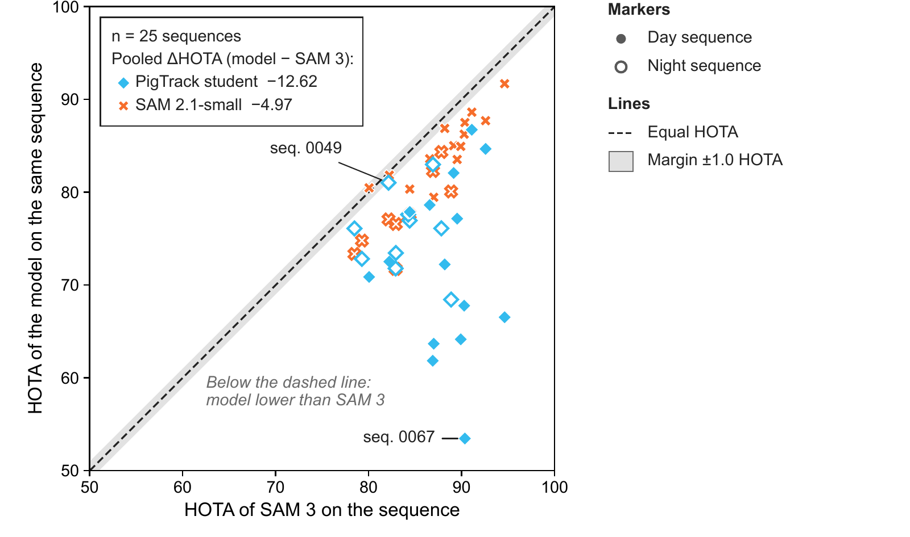
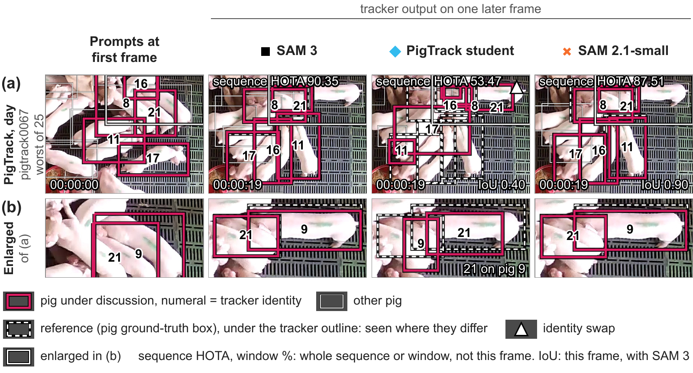
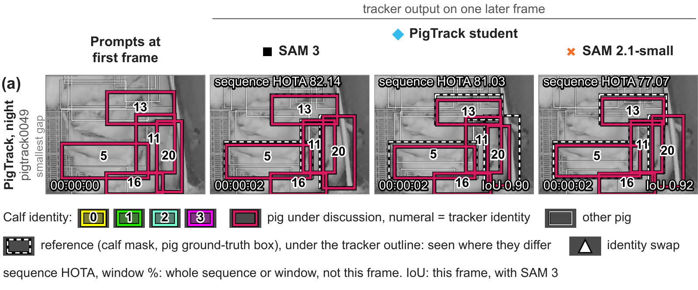
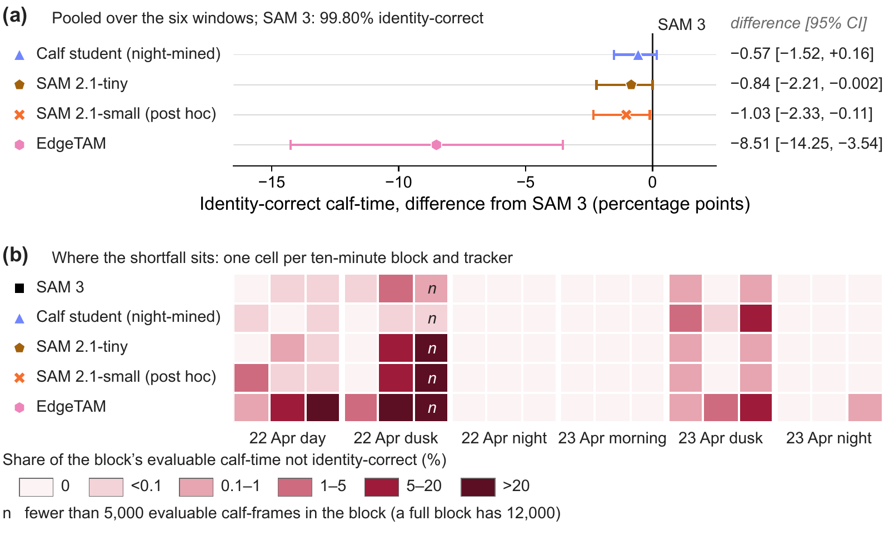
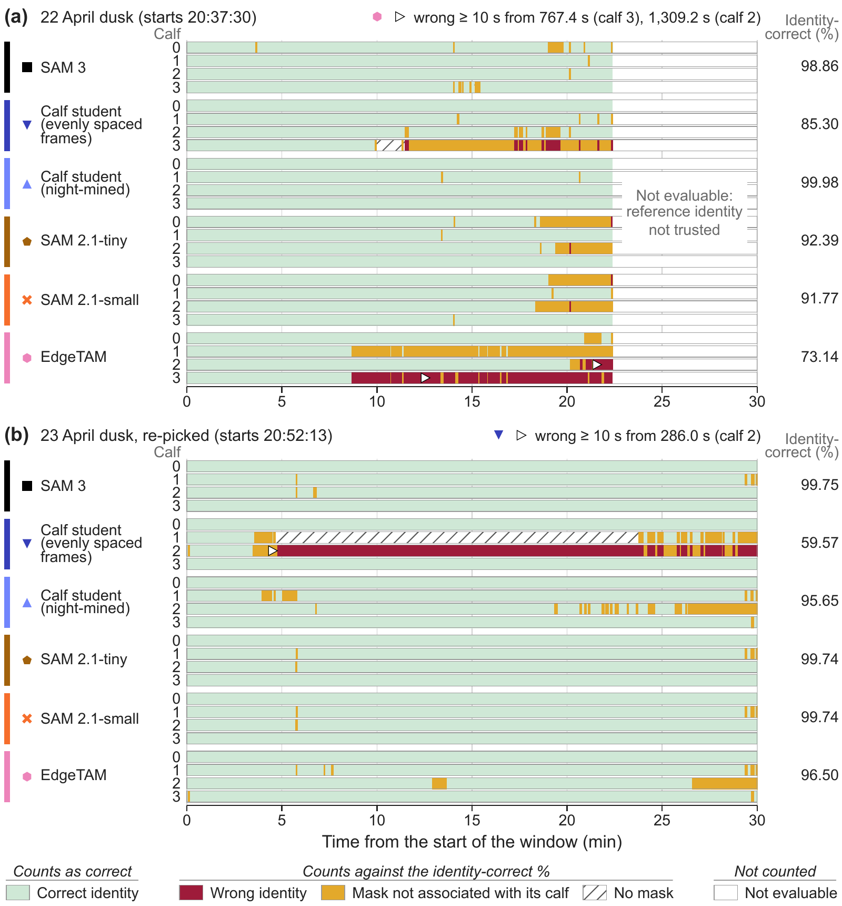
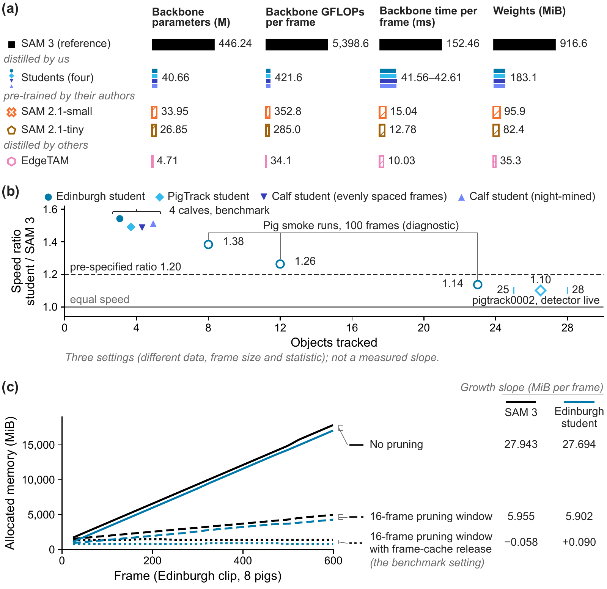
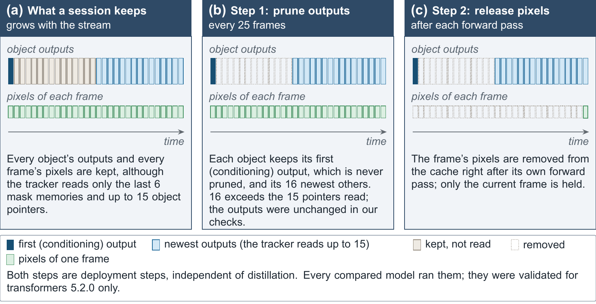
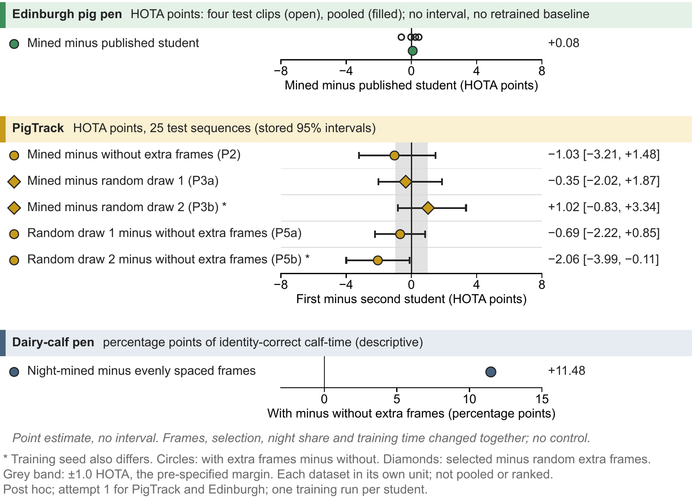
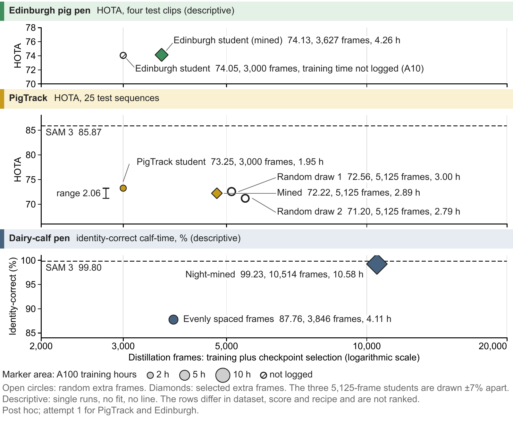
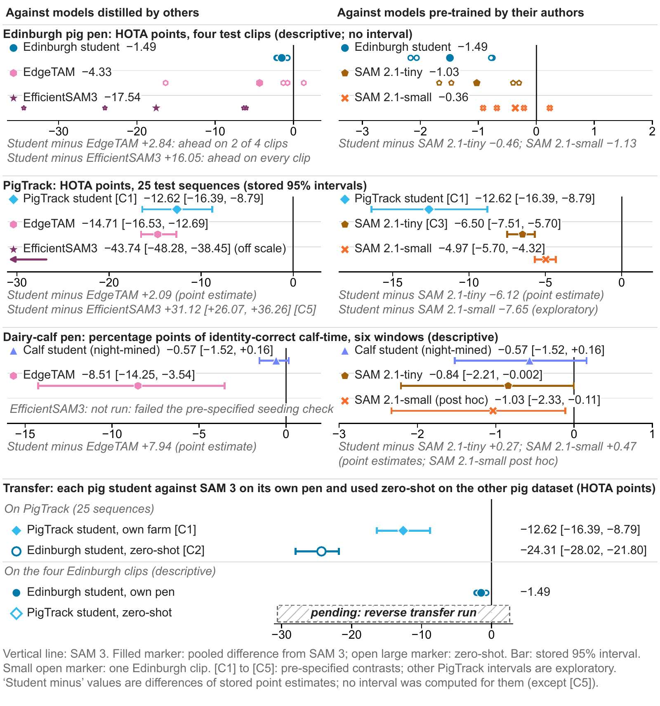

# Results

Every table below is generated from the project's results ledger by [`tools/build_results.py`](../tools/build_results.py). Values are copied, not re-rounded. Each table links to its CSV.

**Terms.** Δ means first model minus second model. A negative ΔHOTA against SAM 3 means the model is worse than SAM 3.
**Protocol A** starts every track from a reference box or mask (oracle-initialised). **Protocol D** puts an RF-DETR detector in the loop.
**Mean TP IoU** is TrackEval's CLEAR MOTP: the mean IoU of matches with IoU ≥ 0.5, × 100.
All runs: A10 vGPU (`NVIDIA A10-24Q`), DBR 17.3 LTS ML GPU, transformers 5.2.0, torch 2.7.0, bf16 weights, SDPA, 16-frame pruning with frame-cache release.

**Verdict words.** PigTrack contrasts carry a pre-specified verdict, with a margin of 1.0 HOTA. Edinburgh and calf numbers are descriptive and carry no verdict.

## Contents

1. [Models](#1-models)
2. [Edinburgh, Protocol A](#2-edinburgh-protocol-a)
3. [Feature fidelity](#3-feature-fidelity)
4. [PigTrack, Protocol A](#4-pigtrack-protocol-a)
5. [Protocol D](#5-protocol-d-detector-in-the-loop)
6. [Dairy calves](#6-dairy-calves)
7. [Efficiency](#7-efficiency)
8. [Frame mining](#8-frame-mining)
9. [Pending](#9-pending)

## 1. Models

| model | backbone parameters | total parameters | GFLOPs, total | GFLOPs, backbone |
|:---|---:|---:|---:|---:|
| SAM 3 | 446,236,672 | 465,782,146 | 9,497.787 | 5,398.574 |
| Edinburgh student | 40,655,408 | 60,200,882 | 4,520.839 | 421.625 |
| PigTrack student | 40,655,408 | 60,200,882 | 4,520.839 | 421.625 |
| PigTrack student without drop-path | 40,655,408 | 60,200,882 | same graph as the PigTrack student | same graph as the PigTrack student |
| Calf student (evenly spaced) | 40,655,408 | 60,200,882 | 4,520.839 | 421.625 |
| Calf student (night-mined) | 40,655,408 | 60,200,882 | 4,520.839 | 421.625 |
| SAM 2.1-tiny | 26,849,472 | 38,962,498 | 2,776.107 | 285.028 |
| SAM 2.1-small | 33,947,328 | 46,060,354 | 2,843.844 | 352.764 |
| EdgeTAM | 4,713,712 | 13,895,794 | 460.097 | 34.119 |
| EfficientSAM3 encoder | 30,650,496 [TinyViT trunk 20,620,416] | 50,195,970 | 4,301.782 | 202.569 |

Data: [`results/models.csv`](../results/models.csv)

GFLOPs are per frame at 4 objects. Total parameters sit next to backbone parameters on purpose: the student system (60.20 M) is larger in total than SAM 2.1-tiny (38.96 M), SAM 2.1-small (46.06 M) and EdgeTAM (13.90 M).

**EfficientSAM3 encoder.** EfficientSAM3 Stage-1 encoder inside SAM 3's unchanged tracker; Stage-2 memory weights unreleased as of 2026-10-08. The module size is 30.65 M [20.62 M TinyViT trunk]. The extracted trunk is never redistributed. Agreement: run on an A10 under our common bf16 protocol; agreement with the authors' code (mean mask IoU): 0.962 Edinburgh / 0.846 crowded PigTrack; we load the checkpoint before eval() so TinyViT attention biases are non-zero; with the authors' code as shipped (eval() before the checkpoint load, TinyViT attention biases left at zero) the agreement is 0.947 Edinburgh / 0.815 crowded PigTrack.

| student | frames (train + selection) | epochs run / best | training time | best EMA val loss | per-patch cosine |
|:---|---:|---:|---:|---:|---:|
| Edinburgh student | 3,000 (2,400 + 600) | 90 / 75 (one A10) | not logged (A10; no recorded time; no estimate) | 0.25042 (quoted from the development record; not re-read from the history file) | 0.7570 on the 4 test clips (480 frames); 0.7508 on the validation clip |
| Edinburgh student (mined) | 3,627 (3,027 + 600) | 85 / 70 (one A100; early stopping) | 4.26 h (15342.1 s; job wall 4.457 h) | 0.24652 (−1.56 % against 0.25042) | 0.7555 on the validation clip (600 frames, fp32; the validation clip chose the checkpoint, so not independent; the published row's 0.7508 is a 120-frame subset, on which M gives 0.7555); not measured on the 4 test clips |
| PigTrack student | 3,000 (2,626 + 374) | 47 / 32 (A100) | 1.95 h (7,003.4 s) | 0.3266 | 0.6807 (374 selection frames of 4 whole held-out sequences) |
| PigTrack student without drop-path | 3,000 | 43 / 28 | 1.77 h (6,364.7 s) | — | 0.6745 |
| PigTrack student (mined) | 5,125 (4,751 + 374) | 42 / 27 | 2.89 h | 0.3268 | 0.6787 |
| PigTrack student (random extra frames, draw 1) | 5,125 | 44 / 29 | 3.00 h | 0.3265 | 0.6807 |
| PigTrack student (random extra frames, draw 2) | 5,125 | 40 / 25 (seed 43) | 2.79 h | 0.3279 | 0.6796 |
| first calf student (evenly spaced frames) | 3,846 (3,505 + 341) | 81 / 66 | 4.11 h | 0.2088 | 0.8013 (training log) |
| calf student (night-mined) | 10,514 (10,173 + 341) | 76 / 61 | 10.58 h (+ 3 h 46 m selection job) | 0.1973 | 0.8121 (training log) |

Data: [`results/recipe.csv`](../results/recipe.csv)

Frames are training plus checkpoint-selection frames. Training time is the sum of per-epoch wall time on one A100 unless stated. The calf cosines are training-log values, with no bench re-check. See [the disclosures](DISCLOSURES.md) for every row with extra frames. The full table, with settings, score and gap, is in the CSV.

## 2. Edinburgh, Protocol A

4 test clips × 600 decoded frames, 8 pigs per clip. **n = 4, one clip at ceiling, so pooled values are descriptive: no interval and no verdict.** The tracks start from reference boxes (oracle-init). The Edinburgh student was distilled on clips of the same pen; every other model is zero-shot.

| model | HOTA | DetA | AssA | LocA | MOTA | IDF1 | IDSW | mean TP IoU | FP / FN |
|:---|---:|---:|---:|---:|---:|---:|---:|---:|---:|
| SAM 3 | 75.5437 | 72.95 | 79.27 | 80.00 | 96.7500 | 98.3750 | 0 | 76.44 | 312 / 312 |
| Edinburgh student | 74.0540 | 70.75 | 78.83 | 79.15 | 95.1667 | 97.5833 | 0 | 75.16 | 464 / 464 |
| SAM 2.1-tiny | 74.5168 | 71.58 | 78.81 | 79.19 | 95.2917 | 97.6458 | 2 | 75.45 | 451 / 451 |
| SAM 2.1-small | 75.1813 | 72.48 | 79.04 | 79.72 | 96.3333 | 98.1667 | 0 | 76.11 | 352 / 352 |
| EdgeTAM | 71.2139 | 66.07 | 78.36 | 79.38 | 86.2604 | 93.1198 | 2 | 75.76 | 1,318 / 1,318 |
| EfficientSAM3 encoder | 58.0042 | 51.09 | 67.32 | 75.48 | 61.4479 | 79.1017 | 45 | 71.41 | 3,248 / 4,109 |

Data: [`results/edinburgh_protA_pooled.csv`](../results/edinburgh_protA_pooled.csv)

The Protocol A rows ran on core `5e705fff…` (the EfficientSAM3 row on core `bc46ecfb…`); the Protocol D rows of Section 5 ran on core `bc46ecfb…`. The Protocol A MOT files of SAM 3 and the Edinburgh student from the `bc46ecfb…` rerun with pruning and frame-cache release are byte-identical on all 4 clips. With the authors' code as shipped (eval() before the checkpoint load, TinyViT attention biases left at zero) the agreement is 0.947 Edinburgh / 0.815 crowded PigTrack.

**Per clip, HOTA.**

| model | 000005 | 000208 | 000060 | 000078 |
|:---|---:|---:|---:|---:|
| SAM 3 | 74.37 | 81.04 | 78.25 | 66.69 |
| Edinburgh student | 72.20 | 80.28 | 76.19 | 65.91 |
| SAM 2.1-tiny | 72.70 | 79.57 | 77.85 | 66.39 |
| SAM 2.1-small | 74.16 | 80.12 | 78.49 | 66.01 |
| EdgeTAM | 73.61 | 64.71 | 79.57 | 65.40 |
| EfficientSAM3 encoder | 68.34 | 46.60 | 71.91 | 42.60 |

Data: [`results/edinburgh_protA_per_clip.csv`](../results/edinburgh_protA_per_clip.csv)

**Per clip, ΔHOTA against SAM 3.**

| model minus SAM 3 | 000005 | 000208 | 000060 | 000078 | pooled, descriptive |
|:---|---:|---:|---:|---:|---:|
| Edinburgh student | −2.17 | −0.75 | −2.06 | −0.78 | −1.49 |
| SAM 2.1-tiny | −1.67 | −1.47 | −0.40 | −0.30 | −1.03 |
| SAM 2.1-small | −0.21 | −0.92 | +0.23 | −0.68 | −0.36 |
| EdgeTAM | −0.76 | −16.33 | +1.32 | −1.29 | −4.33 |
| EfficientSAM3 encoder | −6.04 | −34.44 | −6.34 | −24.08 | −17.54 |

Data: [`results/edinburgh_protA_delta_vs_sam3.csv`](../results/edinburgh_protA_delta_vs_sam3.csv)

The 9-clip table has no student row, because 4 of the 9 clips are the Edinburgh student's training clips ([CSV](../results/edinburgh_protA_nine_clips_no_student.csv)). The older protocol of the preprint is bridged in [`results/edinburgh_old_protocol_bridge.csv`](../results/edinburgh_old_protocol_bridge.csv): those numbers differ in reference, output rule, scorer and pruning, so they must not sit next to the numbers above without saying so.

## 3. Feature fidelity

Per-patch cosine is the mean over the 72×72 positions of the 1,024-d cosine. Global cosine is the cosine of the flattened tensors, the older paper's "cosine". Scale ratio is std(student) / std(SAM 3).

| frames | n | per-patch cosine (± sd) | global cosine | scale ratio | MSE |
|:---|---:|---:|---:|---:|---:|
| 4 held-out test clips | 480 | 0.7570 ± 0.0061 (bf16 0.7569) | 0.7178 | 0.9499 | 1.1071 |
| val clip 2019_11_28_000113 | 120 | 0.7508 | 0.6922 | 0.9558 | 1.1942 |
| first 20 frames of training clip 2019_11_05_000002 (the old paper's "20 held-out frames") | 20 | 0.8173 | 0.8078 | 0.9489 | 0.7631 |

Data: [`results/fidelity_edinburgh.csv`](../results/fidelity_edinburgh.csv)

The 0.808 of the preprint was measured on training frames. The held-out value is 0.7178 global, 0.757 per-patch. An independent re-check with separate code confirmed all 28 primary values.

| student | per-patch cosine (± sd) | global cosine | scale ratio | MSE | day / night per-patch |
|:---|---:|---:|---:|---:|---:|
| PigTrack student (headline) | 0.6807 ± 0.048 | 0.6077 | 0.9304 | 1.5548 | 0.6939 / 0.6691 |
| PigTrack student without drop-path (ablation) | 0.6745 ± 0.045 | 0.5972 | 0.9302 | 1.5944 | 0.6838 / 0.6663 |
| Edinburgh student (zero-shot) | 0.5385 ± 0.020 | 0.4508 | 0.9698 | 2.2568 | 0.5508 / 0.5275 |

Data: [`results/fidelity_pigtrack.csv`](../results/fidelity_pigtrack.csv)

One training run per setting, so the 0.006 gap between the PigTrack student and its variant without drop-path cannot be separated from training noise.

## 4. PigTrack, Protocol A

25 test sequences, 8,939 frames, 180,927 boxes, 15 day and 10 night. Tracks start from reference boxes. Statistics: paired bootstrap of the 25 sequences, B = 10,000, seed 20261014, stratified by day and night, margin 1.0 HOTA.

| model | HOTA | DetA | AssA | LocA | MOTA | IDF1 | IDSW |
|:---|---:|---:|---:|---:|---:|---:|---:|
| SAM 3 | 85.8720 | 83.52 | 88.63 | 90.14 | 92.85 | 95.96 | 41 |
| Edinburgh student (zero-shot) | 61.5665 | 54.47 | 70.97 | 80.45 | 52.18 | 73.61 | 401 |
| PigTrack student | 73.2508 | 67.49 | 80.28 | 84.80 | 73.59 | 85.58 | 141 |
| PigTrack student without drop-path (ablation) | 73.0913 | 67.26 | 80.06 | 84.76 | 73.40 | 85.85 | 124 |
| SAM 2.1-tiny | 79.3755 | 75.41 | 84.23 | 86.78 | 86.07 | 92.53 | 79 |
| SAM 2.1-small | 80.9033 | 76.94 | 85.62 | 87.83 | 86.75 | 92.73 | 71 |
| EdgeTAM | 71.1625 | 66.60 | 76.69 | 84.77 | 69.93 | 83.31 | 282 |
| EfficientSAM3 encoder | 42.1272 | 34.21 | 53.82 | 76.20 | 9.52 | 48.75 | 926 |

Data: [`results/pigtrack_protA.csv`](../results/pigtrack_protA.csv)

**Contrasts, ΔHOTA with 95 % CI.** C1 to C6 were fixed before the run. The last three rows are exploratory.

| contrast | kind | ΔHOTA | CI low | CI high | verdict |
|:---|:---|---:|---:|---:|---:|
| C1 PigTrack student - SAM 3 (primary) | pre-specified | −12.62 | −16.39 | −8.79 | materially worse |
| C2 Edinburgh student - SAM 3 | pre-specified | −24.31 | −28.02 | −21.80 | materially worse |
| C3 SAM 2.1-tiny - SAM 3 | pre-specified | −6.50 | −7.51 | −5.70 | materially worse |
| C4 EfficientSAM3 encoder - Edinburgh student | pre-specified | −19.44 | −24.52 | −13.42 | EfficientSAM3 encoder materially worse |
| C5 PigTrack student - EfficientSAM3 encoder | pre-specified | +31.12 | +26.07 | +36.26 | materially better |
| C6 PigTrack student - Edinburgh student | pre-specified | +11.68 | +6.62 | +17.21 | materially better |
| SAM 2.1-small - SAM 3 | exploratory | −4.97 | −5.70 | −4.32 |  |
| EdgeTAM - SAM 3 | exploratory | −14.71 | −16.53 | −12.69 |  |
| EfficientSAM3 encoder - SAM 3 | exploratory | −43.74 | −48.28 | −38.45 |  |

Data: [`results/pigtrack_contrasts.csv`](../results/pigtrack_contrasts.csv)

The stored sentences:

- **C1.** Even when distilled in-domain, the student loses accuracy on PigTrack (ΔHOTA PigTrack student − SAM 3 = −12.62 [95 % CI −16.39, −8.79]); the accuracy-retention claim is limited to the settings where it was measured.
- **C2.** Distilled students lose accuracy on PigTrack both zero-shot and in-domain (ΔHOTA Edinburgh student − SAM 3 = −24.31 [95 % CI −28.02, −21.80]; PigTrack student − SAM 3 = −12.62 [−16.39, −8.79]).
- **C3.** SAM 3's tracker is materially more accurate than SAM 2.1-tiny on PigTrack (ΔHOTA SAM 2.1-tiny − SAM 3 = −6.50 [95 % CI −7.51, −5.70]), which motivates distilling SAM 3 rather than adopting SAM 2.1-tiny.
- **C4.** Our farm-distilled student transfers better than the generic EfficientSAM3 student, even to an unseen farm (ΔHOTA EfficientSAM3 encoder − Edinburgh student = −19.44 [95 % CI −24.52, −13.42]).
- **C5.** PigTrack student − EfficientSAM3 encoder: ΔHOTA = +31.12 [95 % CI +26.07, +36.26]; in-domain data, head (FPN vs Conv-BN; 40.66 M vs 30.65 M [20.62 M TinyViT trunk]) and loss differ together.
- **C6.** Re-distilling on the target farm changes HOTA by +11.68 points [95 % CI +6.62, +17.21] relative to the zero-shot student (ΔHOTA PigTrack student − Edinburgh student).

C4 and C5 carry the EfficientSAM3 disclosure: run on an A10 under our common bf16 protocol; agreement with the authors' code (mean mask IoU): 0.962 Edinburgh / 0.846 crowded PigTrack; we load the checkpoint before eval() so TinyViT attention biases are non-zero; with the authors' code as shipped (eval() before the checkpoint load, TinyViT attention biases left at zero) the agreement is 0.947 Edinburgh / 0.815 crowded PigTrack.

**Day and night.** The stratum columns are labels, not verdicts.

| model | day HOTA | day AssA | day IDF1 | night HOTA | night AssA | night IDF1 | ΔHOTA vs T, day | ΔHOTA vs T, night |
|:---|---:|---:|---:|---:|---:|---:|---:|---:|
| SAM 3 | 88.39 | 90.58 | 97.10 | 83.50 | 86.63 | 94.90 | — | — |
| Edinburgh student | 64.60 | 72.29 | 77.52 | 58.68 | 69.64 | 69.94 | −23.78 [−30.13, −20.14] | −24.82 [−29.17, −22.03] |
| PigTrack student | 70.82 | 79.11 | 81.29 | 75.56 | 81.29 | 89.62 | −17.57 [−22.77, −10.52] | −7.94 [−10.02, −5.73] |
| PigTrack student without drop-path | 72.99 | 79.76 | 85.19 | 73.18 | 80.31 | 86.47 | (not stored) | (not stored) |
| SAM 2.1-tiny | 83.63 | 86.98 | 95.22 | 75.34 | 81.12 | 90.01 | −4.76 [−5.73, −3.95] | −8.16 [−9.97, −6.87] |
| SAM 2.1-small | 84.40 | 87.54 | 95.50 | 77.61 | 83.60 | 90.13 | −3.98 [−4.59, −3.12] | −5.88 [−7.29, −4.75] |
| EdgeTAM | 74.21 | 79.04 | 85.65 | 68.27 | 74.26 | 81.11 | −14.18 [−16.86, −10.57] | −15.22 [−17.54, −12.76] |
| EfficientSAM3 encoder | 44.90 | 55.22 | 51.49 | 39.44 | 52.38 | 46.14 | −43.49 [−48.35, −36.88] | −44.06 [−51.57, −35.97] |

Data: [`results/pigtrack_day_night.csv`](../results/pigtrack_day_night.csv)

The variant without drop-path is an ablation row; the PigTrack student stays the headline. Its test ΔHOTA against that variant is a verifier computation, not a stored score, and is left out here.

Per-sequence HOTA of each model against SAM 3. Below the dashed line the model is lower than SAM 3.

Lowest HOTA of the 25 test sequences for the PigTrack student, and also the largest shortfall to SAM 3 (−36.88), with overlays added. Frames: PigTrack, CC BY 4.0.

Smallest shortfall to SAM 3 of the 25 test sequences (−1.10 HOTA), night sequence, with overlays added. It is not the highest-scoring sequence for the student: that is pigtrack0030 at 86.74. The figure is a crop of a larger panel; the calf legend entry belongs to the part not shown. Frames: PigTrack, CC BY 4.0.

## 5. Protocol D: detector in the loop

The [protocol facts](DISCLOSURES.md#protocol-facts) on births and dead tracks apply to every row here.

Detector: RF-DETR Small at 512. The threshold τ\* = 0.70 was frozen on PigTrack validation with SAM 3.

| model | HOTA | DetA | AssA | LocA | MOTA | IDF1 | IDSW | FP | FN | HOTA day | HOTA night |
|:---|---:|---:|---:|---:|---:|---:|---:|---:|---:|---:|---:|
| SAM 3 | 77.9936 | 71.40 | 85.51 | 90.12 | 78.64 | 87.87 | 35 | 5,856 | 32,752 | 81.17 | 74.95 |
| PigTrack student | 67.4853 | 59.00 | 77.96 | 84.78 | 63.18 | 78.89 | 117 | 20,906 | 45,596 | 67.13 | 67.82 |
| SAM 2.1-small | 73.6828 | 66.59 | 82.03 | 87.84 | 74.07 | 84.98 | 53 | 10,652 | 36,214 | 77.58 | 69.96 |

Data: [`results/pigtrack_protD.csv`](../results/pigtrack_protD.csv)

**C7.** With an RF-DETR detector in the loop, even when distilled in-domain, the student loses accuracy on PigTrack (ΔHOTA PigTrack student − SAM 3 = −10.51 [95 % CI −14.00, −6.82]); the accuracy-retention claim is limited to the settings where it was measured.

**Edinburgh, Protocol D.** n = 4, descriptive, no interval. `d_edi_v1` is fine-tuned on Edinburgh clips. `d_pt_v1` is the zero-shot sensitivity row.

| detector | model | HOTA | DetA | AssA | MOTA | IDF1 | IDSW | mean TP IoU |
|:---|:---|---:|---:|---:|---:|---:|---:|---:|
| d_edi_v1 | SAM 3 | 70.8906 | 65.34 | 77.89 | 86.2552 | 92.9719 | 0 | 75.92 |
| d_edi_v1 | Edinburgh student | 69.8713 | 63.84 | 77.62 | 84.9479 | 92.3040 | 0 | 74.99 |
| d_edi_v1 | SAM 2.1-small | 70.3029 | 64.71 | 77.40 | 86.3958 | 93.0443 | 0 | 75.21 |
| d_pt_v1 | SAM 3 | 63.8075 | 53.02 | 77.66 | 61.3646 | 82.4426 | 0 | 75.78 |
| d_pt_v1 | Edinburgh student | 63.8607 | 53.50 | 77.32 | 63.4896 | 83.6192 | 0 | 74.61 |
| d_pt_v1 | SAM 2.1-small | 64.0392 | 54.19 | 76.58 | 65.1927 | 84.1157 | 0 | 75.07 |

Data: [`results/edinburgh_protD.csv`](../results/edinburgh_protD.csv)

Births: [`results/protD_births.csv`](../results/protD_births.csv).

## 6. Dairy calves

The 23 April dusk window was re-picked with a rule that used the reference pipeline's detector. See the [window disclosure](DISCLOSURES.md#23-april-dusk-window).

Six 30-minute windows at 5 fps, 9,000 frames each, 4 calves, one overhead pen. 206,690 evaluable calf-frames.

> **Reference.** Calf identity is scored against expert-verified identity chains on masks that the night-mined calf student produced in an earlier tracking run of both days; mask agreement is measured against SAM 3. The masks are not manual segmentations, and calf-frames whose reference identity was not trusted are excluded. Neither reference, the identity chains on the student's masks or the SAM 3 masks, is independent of the SAM 3 family or of that student; which models they favour was not measured. All trackers received the same seed masks. Calf results are descriptive, carry no verdict, and measure seeded-track continuity against this reference, not identity accuracy against independent ground truth.

> **SAM 2.1-small row.** The SAM 2.1-small calf row was added after the other calf results were known, and only after it passed its own seeding gate. Scoring rules, reference, windows, seeds, code and bootstrap are unchanged. The EfficientSAM3 encoder has no calf row: it failed the pre-specified seeding gate on the night window of 22 April, where it stopped emitting 2 of the 4 mask-seeded calves within 4 frames (valid run, no harness defect). Its Edinburgh and PigTrack rows are unaffected. The Edinburgh student was not run on calves.

> **Window.** The 23 April dusk window was re-picked on 2026-10-20, because the seed of animal 0 in the first version sat on a floor patch. The new window is 20:52:13.000 to 21:22:12.8. 6,663 of its 9,000 frames (74 %) lie after 21:00, in the night phase; the pre-specified label "dusk" is kept.

| model | identity-correct % | Δ vs SAM 3 (pp) | CI low | CI high |
|:---|---:|---:|---:|---:|
| SAM 3 | 99.80 |  |  |  |
| Calf student (night-mined) | 99.23 | −0.57 | −1.52 | +0.16 |
| Calf student (evenly spaced) | 87.76 | −12.04 | −15.62 | −8.72 |
| SAM 2.1-tiny | 98.96 | −0.84 | −2.21 | −0.002 |
| EdgeTAM | 91.29 | −8.51 | −14.25 | −3.54 |
| SAM 2.1-small | 98.77 | −1.03 | −2.33 | −0.11 |

Data: [`results/calf_pooled.csv`](../results/calf_pooled.csv)

Paired 10-minute block bootstrap against SAM 3, B = 10,000, seed 20261014, descriptive. These are the only calf intervals printed.

The first calf student does not stay close to SAM 3. Both calf students share the architecture and the recipe; they differ in distillation data and are one training run each.

Pooled gap to SAM 3 and the ten-minute blocks where it sits. Descriptive. The cells are data, not frames.

**By phase, identity-correct % / mask IoU against SAM 3.**

| phase | SAM 3 | Calf student (night-mined) | Calf student (evenly spaced) | SAM 2.1-tiny | EdgeTAM | SAM 2.1-small |
|:---|---:|---:|---:|---:|---:|---:|
| day | 99.95 | 99.96 / 0.948 | 82.05 / 0.936 | 99.96 / 0.954 | 73.64 / 0.747 | 99.30 / 0.948 |
| dusk | 99.37 | 97.50 / 0.709 | 70.56 / 0.536 | 96.60 / 0.807 | 86.52 / 0.701 | 96.34 / 0.845 |
| morning | 100.00 | 100.00 / 0.965 | 100.00 / 0.956 | 100.00 / 0.960 | 100.00 / 0.953 | 100.00 / 0.964 |
| night | 100.00 | 100.00 / 0.905 | 99.48 / 0.871 | 100.00 / 0.898 | 99.88 / 0.849 | 100.00 / 0.911 |

Data: [`results/calf_by_phase.csv`](../results/calf_by_phase.csv)

**By window, identity-correct %.** Merge, fragment and coverage percentages are in the CSV.

| window | SAM 3 | Calf student (night-mined) | Calf student (evenly spaced) | SAM 2.1-tiny | EdgeTAM | SAM 2.1-small |
|:---|---:|---:|---:|---:|---:|---:|
| 0422_day | 99.95 | 99.96 | 82.05 | 99.96 | 73.64 | 99.30 |
| 0422_dusk | 98.86 | 99.98 | 85.30 | 92.39 | 73.14 | 91.77 |
| 0422_night | 100.00 | 100.00 | 100.00 | 100.00 | 100.00 | 100.00 |
| 0423_morning | 100.00 | 100.00 | 100.00 | 100.00 | 100.00 | 100.00 |
| 0423_dusk (v2, re-picked) | 99.75 | 95.65 | 59.57 | 99.74 | 96.50 | 99.74 |
| 0423_night | 100.00 | 100.00 | 98.97 | 100.00 | 99.76 | 100.00 |

Data: [`results/calf_by_window.csv`](../results/calf_by_window.csv)

No frame of 23 April appears in this repository. Those windows stay in the tables as numbers only.

Frame-level timeline of the two dusk windows. Quantities are seeded-track continuity, not identity accuracy.

## 7. Efficiency

The [protocol facts](DISCLOSURES.md#protocol-facts) apply here too.

**Every number in the first two tables is at 4 objects.** Input: calf window of the night of 22 April, 2304×1296 frames, 32 warm-up plus 500 timed frames, decode in the loop. For students the "model span" excludes the student, which runs outside the Hugging Face graph.

(a) Size and compute of the swap. (b) Speed ratio against objects tracked: three settings, not a measured slope. (c) Memory against frame count with and without pruning.

**Latency, ms per frame, median [IQR].**

| model | backbone / student | neck | memory attention | memory encoder | mask decoder | model span | wall / frame | e2e fps [IQR] |
|:---|---:|---:|---:|---:|---:|---:|---:|---:|
| SAM 3 | 152.46 [151.45, 153.14] | 4.31 | 108.63 | 10.42 | 5.86 | 285.72 | 307.85 | 3.2483 [3.2272, 3.2725] |
| Edinburgh student | 41.56 [41.41, 41.99] | 4.94 | 109.39 | 10.26 | 5.65 | 134.18 | 199.65 | 5.0087 [4.9538, 5.0523] |
| PigTrack student | 42.23 [41.99, 42.81] | 4.93 | 109.34 | 10.26 | 5.64 | 134.11 | 206.43 | 4.8444 [4.7991, 4.9349] |
| Calf student (evenly spaced) | 42.61 [42.25, 43.54] | 4.93 | 109.41 | 10.26 | 5.65 | 134.17 | 207.24 | 4.8253 [4.7616, 4.9111] |
| Calf student (night-mined) | 41.64 [41.38, 42.01] | 4.94 | 109.31 | 10.26 | 5.63 | 134.07 | 203.49 | 4.9143 [4.8539, 4.9743] |
| SAM 2.1-tiny | 12.78 [12.66, 12.91] | 1.92 | 73.32 | 8.04 | 4.60 | 104.09 | 124.98 | 8.0014 [7.9022, 8.0542] |
| SAM 2.1-small | 15.04 [14.90, 15.14] | 1.92 | 73.58 | 8.11 | 4.65 | 106.68 | 127.78 | 7.8262 [7.7553, 7.8645] |
| EdgeTAM | 10.03 [9.71, 10.68] | 2.66 | 12.91 | 6.74 | 11.15 | 55.19 | 76.65 | 13.0471 [12.7322, 13.3440] |
| EfficientSAM3 encoder | 16.95 [16.92, 16.98] | 4.91 | 108.58 | 10.26 | 5.61 | 150.36 | 211.03 | 4.7386 [4.6838, 4.7931] |

Data: [`results/efficiency_latency.csv`](../results/efficiency_latency.csv)

**Memory, MiB,** 2,500 frames, peak reset after frame 31.

| model | weights | CUDA context | steady peak allocated / reserved | session tensors | growth OLS (MiB / frame) | reserved peak + context | fits an A10 |
|:---|---:|---:|---:|---:|---:|---:|---:|
| SAM 3 | 916.6 | 2,405.6 | 1,928.95 / 2,056 | 259.17 | −0.0055 | 4,461.6 | yes |
| Edinburgh student | 183.1 | 2,455.6 | 1,443.18 / 1,602 | 259.17 | +0.0135 | 4,057.6 | yes |
| PigTrack student | 183.1 | 2,455.6 | 1,289.31 / 1,442 | 259.17 | +0.0012 | 3,897.6 | yes |
| Calf student (evenly spaced) | 183.1 | 2,455.6 | 1,296.90 / 1,462 | 259.17 | +0.0014 | 3,917.6 | yes |
| Calf student (night-mined) | 183.1 | 2,455.6 | 1,289.31 / 1,462 | 259.17 | −0.0032 | 3,917.6 | yes |
| SAM 2.1-tiny | 82.4 | 2,405.6 | 963.71 / 1,044 | 238.53 | −0.0022 | 3,449.6 | yes |
| SAM 2.1-small | 95.9 | 2,405.6 | 984.14 / 1,112 | 238.53 | +0.0133 | 3,517.6 | yes |
| EdgeTAM | 35.3 | 2,405.6 | 404.21 / 600 | 75.03 | +0.0102 | 3,005.6 | yes |
| EfficientSAM3 encoder | 113.3 | 2,443.6 | 1,061.21 / 1,224 | 259.17 | +0.0064 | 3,667.6 | yes |

Data: [`results/efficiency_memory.csv`](../results/efficiency_memory.csv)

Energy per frame is not available on the vGPU; none was estimated. No embedded device was measured.

**Concurrent streams per A10.** Analytic, not measured. Every SAM 3-tracker model adds the same 249.95 MiB per stream, because the per-stream state belongs to the tracker, not the backbone.

| model | level_after_first_pass_mib | per_stream_mib | streams |
|:---|---:|---:|---:|
| SAM 3 | 981.01 | 249.95 | 84 |
| Edinburgh student, PigTrack student, Calf student (evenly spaced), Calf student (night-mined) | 389.45 | 249.95 | 86 |
| SAM 2.1-tiny | 124.48 | 251.24 | 87 |
| SAM 2.1-small | 138.02 | 251.24 | 87 |
| EdgeTAM | 75.93 | 89.74 | 246 |
| EfficientSAM3 encoder | 177.77 | 249.95 | 87 |

Data: [`results/efficiency_streams.csv`](../results/efficiency_streams.csv)

**Pruning factorial.** SAM 3 and the Edinburgh student on the 4 Edinburgh test clips. Peak and end-of-clip memory are maxima over the 4 clips.

| model | level | HOTA | MOTA | IDF1 | IDSW | peak allocated MiB | end allocated MiB | OLS slope range (MiB / frame) |
|:---|:---|---:|---:|---:|---:|---:|---:|---:|
| SAM 3 | none (no pruning, no pop) | 75.5437 | 96.75 | 98.375 | 0 | 18,086.6 | 17,812.7 | 27.58 to 27.94 |
| SAM 3 | k8 (no pop) | 75.4601 | 96.7396 | 98.3698 | 0 | 5,631.1 | 4,811.2 | 5.68 to 5.97 |
| SAM 3 | k16 (no pop) | 75.5437 | 96.75 | 98.375 | 0 | 5,891.6 | 5,088.5 | 5.80 to 5.96 |
| SAM 3 | k16 + pop | 75.5437 | 96.75 | 98.375 | 0 | 2,323.3 | 1,497.6 | −0.058 to +0.032 |
| Edinburgh student | none | 74.0540 | 95.1667 | 97.5833 | 0 | 17,335.4 | 17,051.4 | 27.65 to 27.72 |
| Edinburgh student | k8 | 74.0552 | 95.1563 | 97.5781 | 0 | 5,059.8 | 4,229.8 | 5.66 to 5.93 |
| Edinburgh student | k16 | 74.0540 | 95.1667 | 97.5833 | 0 | 5,187.1 | 4,357.0 | 5.66 to 5.90 |
| Edinburgh student | k16 + pop | 74.0540 | 95.1667 | 97.5833 | 0 | 1,752.0 | 916.1 | −0.143 to +0.090 |

Data: [`results/pruning_factorial.csv`](../results/pruning_factorial.csv)

The memory bound comes from pruning plus frame-cache release, not from distillation. Keeping 8 outputs is not lossless: k8 differs from k16 on every clip. k16 is output-identical to no pruning.

What the session keeps and the two steps that bound it. Both are deployment steps, independent of distillation.

**End to end with the detector live.**

| run | objects | detector per call, ms | backbone / student, ms | memory attention, ms | wall / frame, ms | e2e fps median [IQR] (mean) | fits an A10 |
|:---|:---|---:|---:|---:|---:|---:|---:|
| d_pt_v1 + SAM 3, pigtrack0002 (985 frames) | 19 seeds → 25 | 15.25 | 160.37 | 686.56 | 977.86 | 1.0226 [1.0208, 1.0626] (1.0514) | not assessable |
| d_pt_v1 + PigTrack student, pigtrack0002 | 19 seeds → 28 (2 deaths) | 14.75 | 38.17 | 702.10 | 888.26 | 1.1258 [1.0893, 1.1554] (1.1492) | not assessable |
| segv1d + Calf student (night-mined), 0422_night, 2,500 frames | 4 | 33.18 | 42.82 | 110.37 | 204.47 | 4.8908 [4.6874, 4.9781] (4.7342) | yes |

Data: [`results/efficiency_end_to_end.csv`](../results/efficiency_end_to_end.csv)

The stored "does not fit" on the two PigTrack runs means **not assessable**: pigtrack0002 has 985 frames, fewer than the 2,000 that the slope test needs. End-to-end speed on that sequence is about equal (ratio 1.10), under unequal loads: 25 objects in the session for SAM 3 against 28 for the student, of which 26 alive, and memory attention 686.56 against 702.10 ms.

## 8. Frame mining

All mining rows are post hoc, attempt 1, one training run per student. See [the disclosures](DISCLOSURES.md) before you use any row of this section.

### PigTrack

| model | HOTA | day (15) | night (10) | DetA | AssA | MOTA | IDF1 | IDSW |
|:---|---:|---:|---:|---:|---:|---:|---:|---:|
| SAM 3 | 85.87 | 88.39 | 83.50 | 83.52 | 88.63 | 92.85 | 95.96 | 41 |
| SAM 2.1-small (zero-shot) | 80.90 | 84.40 | 77.61 | 76.94 | 85.62 | 86.75 | 92.73 | 71 |
| PigTrack student (3,000 targets) | 73.25 | 70.82 | 75.56 | 67.49 | 80.28 | 73.59 | 85.58 | 141 |
| PigTrack student (mined) | 72.22 | 68.36 | 75.87 | 65.67 | 80.32 | 71.04 | 84.75 | 114 |
| PigTrack student (random extra frames, draw 1) | 72.56 | 70.41 | 74.58 | 66.01 | 80.65 | 70.61 | 84.43 | 151 |
| PigTrack student (random extra frames, draw 2) | 71.20 | 67.27 | 74.89 | 64.27 | 79.81 | 67.92 | 83.09 | 145 |

Data: [`results/mining_pigtrack_tracking.csv`](../results/mining_pigtrack_tracking.csv)

**Contrasts.** Delta is first minus second, overall HOTA, night-stratified paired bootstrap, B = 10,000, seed 20261014, margin 1.0, no multiplicity correction.

| id | contrast (first minus second) | delta | 95 % CI | verdict |
|:---|:---|---:|---:|---:|
| P1 | mined minus SAM 2.1-small | −8.69 | [−14.04, −4.05] | materially worse |
| P2 | mined minus PigTrack student | −1.03 | [−3.21, +1.48] | inconclusive |
| P3a | mined minus random draw 1 | −0.35 | [−2.02, +1.87] | inconclusive |
| P3b | mined minus random draw 2 | +1.02 | [−0.83, +3.34] | non-inferior |
| P3 | read from the less favourable (P3a) |  |  | inconclusive |
| P4 | mined minus SAM 3 | −13.66 | [−19.04, −8.90] | materially worse |
| P5a | random draw 1 minus PigTrack student | −0.69 | [−2.22, +0.85] | inconclusive |
| P5b | random draw 2 minus PigTrack student | −2.06 | [−3.99, −0.11] | inconclusive |

Data: [`results/mining_pigtrack_contrasts.csv`](../results/mining_pigtrack_contrasts.csv)

The registered sentences:

- **P1 (materially worse):** On PigTrack (25 test sequences), in HOTA, with oracle-initialised prompts (Protocol A), even with 2,125 hard-mined frames added, the distilled student remains less accurate than zero-shot SAM 2.1-small (ΔHOTA mined − SAM 2.1-small = -8.69 [95 % CI -14.04, -4.05]) (one training run); the added frames did not close the gap. The student is larger than SAM 2.1-small (60.20 M vs 46.06 M total parameters), slower end to end on the A10 (1.45 vs 2.10 fps; peak 3,951 vs 3,489 MiB) and, unlike zero-shot SAM 2.1-small, was distilled on 4,751 frames of PigTrack training sequences recorded in all nine pens that also occur in the test set.
- **P2 (inconclusive):** 25 sequences do not resolve the effect of adding 2,125 hard-mined near-duplicate frames on PigTrack accuracy (ΔHOTA mined − PigTrack student = -1.03 [95 % CI -3.21, +1.48]; one training run per arm).
- **P3 (inconclusive; governing contrast P3a; first value draw R, second draw R2):** 25 sequences do not resolve whether hard mining beats random selection of the same number of extra frames (ΔHOTA = -0.35 [95 % CI -2.02, +1.87] / +1.02 [95 % CI -0.83, +3.34]; one training run per arm); where one draw is resolved and the other is not, replication is not met; no claim about mining is made.
- **P4 (materially worse):** On PigTrack (25 test sequences), in HOTA, with oracle-initialised prompts (Protocol A), a gap to the SAM 3 teacher remains after mining (ΔHOTA mined − SAM 3 = -13.66 [95 % CI -19.04, -8.90]) (one training run).
- **P5a (inconclusive):** 25 sequences do not resolve the effect of adding 2,125 randomly chosen near-duplicate frames (ΔHOTA random − PigTrack student = -0.69 [95 % CI -2.22, +0.85]; one training run per arm).
- **P5b (draw R2; qualifier rule; not a row of the registered sentence table, so no claim rests on it):** Adding 2,125 randomly chosen near-duplicate frames and the proportionally longer epochs: the random-frame student (draw R2, training seed 43) is less accurate than the base student (ΔHOTA random2 − PigTrack student = -2.06 [95 % CI -3.99, -0.11]; one training run per arm); the 95 % CI excludes zero (upper bound -0.11) but not the 1.0-point margin: the direction is resolved, a material difference is not. **Caveat that travels with this sentence (b1.8 item 2(a)):** R2 differs from PigTrack student in the 2,125 extra rows, the longer epochs and the training seed (43 against 42, hence a different initialisation of the layers not loaded from ImageNet), so P5b is not a one-factor contrast and is not an effect of the frames alone. It is one of seven verdict contrasts without multiplicity correction.

Each dataset in its own unit, not pooled or ranked. Edinburgh row: see the disclosure block.

Fidelity, training and the diagnostics of the extra sets: [`mining_pigtrack_fidelity.csv`](../results/mining_pigtrack_fidelity.csv), [`mining_pigtrack_training.csv`](../results/mining_pigtrack_training.csv), [`mining_pigtrack_diagnostics.csv`](../results/mining_pigtrack_diagnostics.csv), [`mining_pigtrack_secondary.csv`](../results/mining_pigtrack_secondary.csv).

### Dairy calves, first student and night-mined student

Descriptive, one run each, no control. Point estimate, no interval computed: +11.48 points of identity-correct calf-time. The first student's night failure that motivated the selection was found on 22 April, a development day that also supplies three of the six evaluation windows. Frames, selection, night share and training time changed together. The night-mined student made the reference masks.

| quantity | first calf student | night-mined calf student |
|:---|---:|---:|
| distillation frames used (training + checkpoint selection) | 3,846 (3,505 + 341; DERIVED) | 10,514 (10,173 + 341) |
| training time (sum of per-epoch wall time, one A100) | 4.11 h | 10.58 h (38,084.1 s) |
| pooled identity-correct calf-time (206,690 evaluable calf-frames) | 87.76 % (87.757027) | 99.23 % (99.232667) |
| gap to SAM 3 with the stored 95 % block-bootstrap interval (18 ten-minute blocks, 3 per window; B = 10,000; seed 20261014; descriptive) | −12.04 [−15.62, −8.72] | −0.57 [−1.52, +0.16] |
| sustained identity errors (10 s or longer) | 1 (23 April dusk, calf 2, at 286.0 s) | 0 |

Data: [`results/calf_first_vs_night_mined.csv`](../results/calf_first_vs_night_mined.csv)

Descriptive: single runs, no fit, no line. The rows differ in dataset, score and recipe and are not ranked. Edinburgh point: see the disclosure block.

### Edinburgh

This is the only wording used for this experiment. It carries no label of direction. The disclosure block is in [DISCLOSURES.md](DISCLOSURES.md#edinburgh-mining-disclosure-block).

> On the 4 Edinburgh test clips, pooled HOTA of the Edinburgh student retrained with 627 extra frames (Edinburgh student (mined): the 209 frames with the lowest Edinburgh student pig-cell cosine in each of three unused November clips; one training run, seed 42, A100) minus pooled HOTA of the published Edinburgh student (Edinburgh student) was +0.07921093325286677 (per clip +0.45153938655305126, +0.24365919707604178, -0.6163228892565229, -0.025580558435834178; DetA +0.008671135383551132, AssA +0.19399639473125774). The difference includes the extra frames, the training seed (the published student had none), the GPU, runtime and library change, local-disk data loading and 26 % more optimiser steps per epoch; there is no retrained baseline and no random-frame control, so it is not attributable to the selection of the extra frames. There is no noise reference in this experiment (a different pair, PigTrack's two random-frame students, differed by 1.37 pooled HOTA on 25 sequences from 9 pens; with n = 4 clips here, pooled retraining noise would be larger for a comparable per-clip spread). One training run; n = 4 clips, no confidence interval. A third of the extra frames (209) come from 2019_11_11_000016, a nearly static clip (99.7 % static frames) that is a near-copy of a training scene in SAM 3 feature space. The pool is three November clips, including 2019_11_11_000016 (annotations wrong) and 2019_11_05_000009 and 2019_11_15_000033 (annotations not used). Post hoc (requested after the Edinburgh and PigTrack results were known); attempt 1 for Edinburgh; Edinburgh never overrides PigTrack.

Values: [`mining_edinburgh_pooled.csv`](../results/mining_edinburgh_pooled.csv), [`mining_edinburgh_per_clip.csv`](../results/mining_edinburgh_per_clip.csv).

### Differences against other models

Point estimates of stored means. Rows are not ranked against each other.

| dataset | student minus comparator | difference | unit | label |
|:---|:---|---:|---:|---:|
| Edinburgh | Edinburgh student minus EdgeTAM | +2.84 | HOTA points, pooled, 4 clips | descriptive (n = 4, no interval) |
| Edinburgh | Edinburgh student minus the EfficientSAM3 encoder | +16.05 | HOTA points | descriptive; encoder only; parity check failed (both parts of the [disclosure](DISCLOSURES.md#efficientsam3-encoder)) |
| Edinburgh | Edinburgh student minus SAM 2.1-small | −1.13 | HOTA points | descriptive |
| Edinburgh | Edinburgh student minus SAM 2.1-tiny | −0.46 | HOTA points | descriptive |
| PigTrack | PigTrack student minus EdgeTAM | +2.09 | HOTA points, 25 sequences | point estimate; not pre-specified; no interval |
| PigTrack | PigTrack student minus SAM 2.1-small | −7.65 | HOTA points | exploratory, not pre-specified |
| PigTrack | PigTrack student minus SAM 2.1-tiny | −6.12 | HOTA points | point estimate; no interval |
| calves | night-mined calf student minus the first calf student | +11.48 | percentage points of identity-correct calf-time | point estimate; no interval computed; post hoc |
| calves | night-mined calf student minus SAM 2.1-tiny | +0.27 | percentage points | point estimate; no interval computed |
| calves | night-mined calf student minus SAM 2.1-small | +0.47 | percentage points | point estimate; no interval computed; post hoc (this calf row was added after the other calf results were known) |
| calves | night-mined calf student minus EdgeTAM | +7.94 | percentage points | point estimate; no interval computed |

Data: [`results/point_estimate_differences.csv`](../results/point_estimate_differences.csv)

## 9. Pending

**Reverse transfer.** The PigTrack student used zero-shot on the four Edinburgh test clips. The run is pending, so no number exists. The "transfer" panel below holds an empty slot for it.

Gaps to SAM 3 per dataset. Filled marker: pooled difference. Bar: stored 95 % interval where one exists. Open markers: per-clip values. The 'pending' row has no number.

Machine-readable tables from the runs: [`results/scores/`](../results/scores/).
